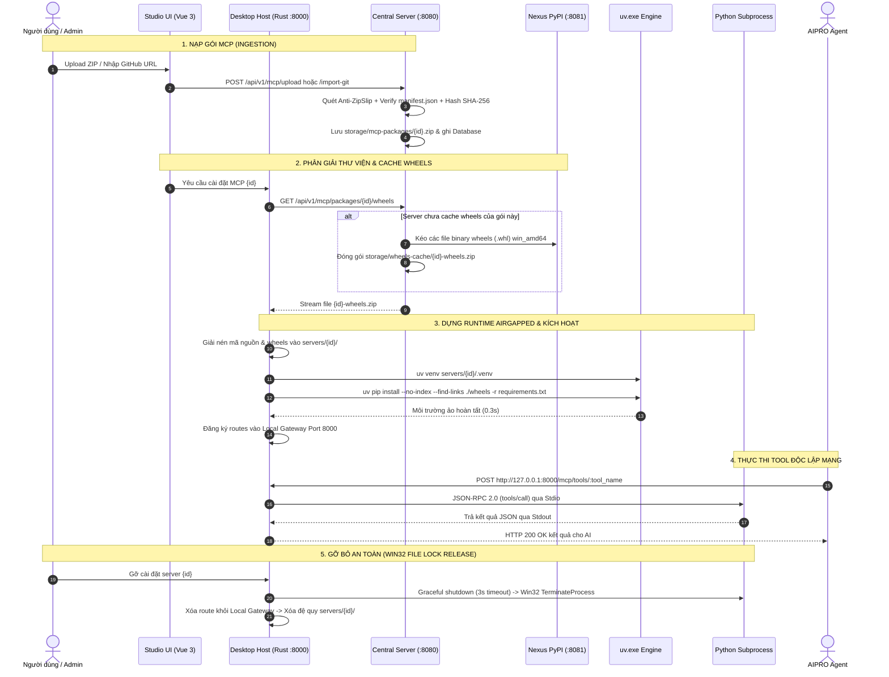
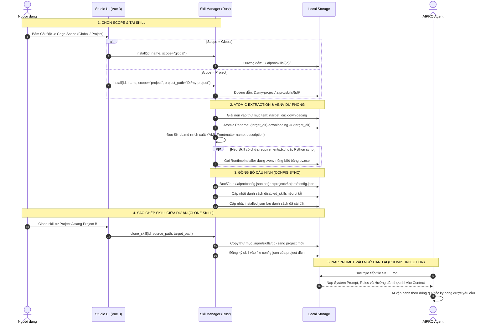
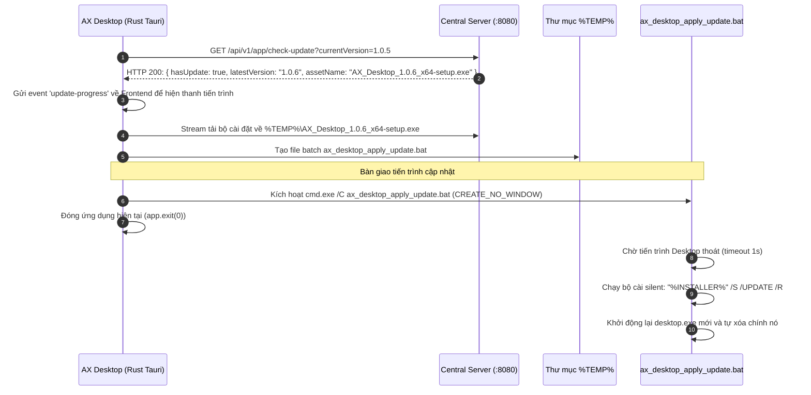

# ĐẶC TẢ TOÀN DIỆN KIẾN TRÚC & WORKFLOW DỰ ÁN CHO AI TRIỂN KHAI
## (Full Architecture, Dual-Track Workflows & Implementation Blueprint)

> **Mục tiêu tài liệu:** Cung cấp tài liệu kỹ thuật hoàn chỉnh 100%, bóc tách chi tiết từng dòng logic nghiệp vụ của cả **Track A (MCP Protocol Studio)** và **Track B (Skill Marketplace & Scope Management)**, cùng hệ thống **Central Java Server (Spring Boot 3 + Nexus Gateway)** và **Desktop App Host (Rust Tauri v2 + Vue 3)**. Bất kỳ AI Agent nào khi tiếp nhận tài liệu này đều có thể tự tin triển khai, mở rộng hoặc sửa đổi toàn bộ tính năng mà không cần hỏi lại.

---

## 1. Sơ Đồ Trực Quan Tương Tác (Archify Interactive Diagram)

Sơ đồ đã được cập nhật phân tầng đầy đủ 4 Swimlanes & 6 Giai đoạn (Phases) theo chuẩn **Archify Showcase Quality Profile**:
* 🌐 **Mở xem trực tiếp sơ đồ tương tác (Live Signal-Flow Trace):** [`project-backend-master-workflow.html`](./project-backend-master-workflow.html)
* 📋 **Mã nguồn cấu trúc JSON của Archify:** [`project-backend-master-workflow.json`](./project-backend-master-workflow.json)

---

## 2. Bảng So Sánh Cốt Lõi: MCP Server vs Agent Skill

Đây là điểm mấu chốt để AI phân biệt chính xác logic của hai phân hệ:

| Tiêu chí | Track A: MCP Server (Model Context Protocol) | Track B: Skill (Agent Prompt & Tool Skill) |
| :--- | :--- | :--- |
| **Bản chất** | **Background Daemon Service** (Tiến trình chạy nền lâu dài) | **Prompt-First Context** (Tập hướng dẫn hành vi + script phụ trợ) |
| **Giao thức giao tiếp** | JSON-RPC 2.0 qua `stdio`, `sse`, hoặc `websocket` | Nạp prompt trực tiếp (`SKILL.md`) vào Context của AI Agent |
| **Phạm vi lưu trữ** | Thư mục trạm `servers/{id}/` | **Global** (`~/.aipro/skills/{id}`) hoặc **Project** (`<project>/.aipro/skills/{id}`) |
| **Cơ chế cấu hình** | Bảng định tuyến HTTP Gateway (`http://127.0.0.1:8000/mcp/tools/:name`) | Đồng bộ file cấu hình `config.json` (`disabled_skills` array) |
| **Vòng đời / Thoát** | Quản lý PID subprocess, Win32 `TerminateProcess` tránh file locks | Bật/Tắt (Toggle) qua `config.json`, Sao chép giữa dự án (`clone_skill`) |
| **Dependencies** | Bắt buộc Virtualenv riêng (`.venv`) tạo bởi `uv.exe` và wheels | Chỉ tạo `.venv` khi skill có chứa mã Python/`requirements.txt` |

---

## 3. TRACK A: NGHIỆP VỤ MCP SERVER CHI TIẾT



### Các bước kỹ thuật nghiêm ngặt của Track A:
1. **Kiểm tra Anti-ZipSlip:** Không cho phép bất kỳ file nào trong archive giải nén ra ngoài thư mục đích (`entry.getName().contains("..")` bị ném `SecurityException`).
2. **Nexus Auth Shield:** Máy Client không chứa thông tin đăng nhập Nexus. Java Server dùng Service Account nội bộ để giao tiếp với Nexus 3.
3. **Win32 TerminateProcess:** Trên Windows, file `.pyd` hay file thực thi `.exe` trong `.venv` đang chạy sẽ bị OS khóa độc quyền. Phải dừng PID trước khi thực hiện `fs::remove_dir_all` để tránh `OS Error 5 (Access Denied)`.

---

## 4. TRACK B: NGHIỆP VỤ SKILL (AGENT SKILLS) CHI TIẾT



### Các bước kỹ thuật nghiêm ngặt của Track B:
1. **Quản lý 2 cấp độ Scope:**
   * `global`: Thư mục cố định `%USERPROFILE%\.aipro\skills\{id}`. Mọi dự án đều nhìn thấy skill này trừ khi bị ghi đè.
   * `project`: Nằm cục bộ tại `{project_path}\.aipro\skills\{id}`. Chỉ có hiệu lực khi làm việc trong project đó.
2. **Cơ chế Bật/Tắt (Toggle):** Không xóa file, mà ghi tên skill vào mảng `disabled_skills` trong file `config.json`. Agent khi khởi động sẽ đọc file này để bỏ qua các skill bị tắt.
3. **Atomic Install:** Giải nén vào `{id}.downloading` trước. Khi toàn bộ file đã an toàn mới tiến hành đổi tên thư mục sang `{id}`. Tránh tình trạng file bị corrupt khi đang tải/giải nén dở dang.

---

## 5. TRACK C: AUTO-UPDATER CHO DESKTOP APP

Cơ chế cập nhật ứng dụng tự động hoạt động theo luồng không làm gián đoạn:



---

## 6. Bảng Hợp Đồng API Central Java Server

| Phương thức | Endpoint | Tham số / Payload | Mô tả chức năng |
| :--- | :--- | :--- | :--- |
| **`POST`** | `/api/v1/mcp/upload` | Multipart: `file` (.zip) | Upload mã nguồn server/skill |
| **`POST`** | `/api/v1/mcp/import-git` | JSON: `{ repoUrl, branch, token }` | Nhập trực tiếp từ GitHub / GitLab |
| **`GET`** | `/api/v1/mcp/packages` | Query: `query`, `category` | Danh mục tổng hợp MCP và Skills |
| **`GET`** | `/api/v1/mcp/packages/{id}` | Path: `id` | Chi tiết metadata, schemas, tools |
| **`GET`** | `/api/v1/mcp/download/{id}` | Path: `id` | Tải file `.zip` mã nguồn (~20KB) |
| **`GET`** | `/api/v1/mcp/packages/{id}/wheels` | Path: `id` | Tải gói wheels Windows từ Nexus |
| **`DELETE`**| `/api/v1/mcp/packages/{id}` | Path: `id` | Server Purge (Xóa mã nguồn & cache wheels) |
| **`GET`** | `/api/v1/app/check-update` | Query: `currentVersion` | Kiểm tra phiên bản Desktop App |
| **`GET`** | `/api/v1/app/download/{asset}` | Path: `asset` | Tải installer setup (.exe) |

---

## 7. Cấu Trúc File & Thư Mục Trọng Yếu

```text
D:\mcp-server-test/
├── apps/desktop/src/
│   ├── main.rs                 # Khởi chạy Tauri application
│   ├── lib.rs                  # Window manager & Tray icon
│   └── commands.rs             # 25+ IPC Commands nối Frontend với Core
├── bin/
│   └── uv.exe                  # Công cụ quản lý Python venv offline siêu tốc
├── crates/
│   ├── mcp-core/               # Xử lý MCP Catalog, Installer, Subprocess
│   ├── skill-core/             # Quản lý Skill, Scope, Config Sync, Auto-Updater
│   ├── win11-platform/         # Win32 DWM Mica/Acrylic, Autostart, File locks
│   └── shared-types/           # Rust structs & TypeScript model bindings
├── docs/architecture/
│   ├── project-backend-master-workflow.html # Sơ đồ Archify tương tác
│   ├── project-backend-master-workflow.json # Cấu trúc JSON sơ đồ
│   └── AI_IMPLEMENTATION_BLUEPRINT.md       # Bản đặc tả kỹ thuật này
└── target/release/
    ├── desktop.exe             # Ứng dụng Desktop chạy độc lập (10.72 MB)
    └── bundle/nsis/*.exe       # Bộ cài đặt Windows Setup (6.01 MB)
```

```text
D:\mcp-central-server/
├── src/main/java/com/company/mcp/
│   ├── controller/
│   │   ├── McpCatalogController.java     # /api/v1/mcp/packages
│   │   ├── McpPackageController.java     # /api/v1/mcp/upload, /download, /wheels
│   │   └── AppUpdateController.java      # /api/v1/app/check-update, /download
│   ├── service/
│   │   ├── PackageStorageService.java   # Lưu trữ, Anti-ZipSlip, tính SHA-256
│   │   └── DependencyGatewayService.java# Proxy Nexus 3 PyPI kéo .whl
│   └── entity/                          # McpPackage, McpTool, McpEnvRequirement
├── storage/
│   ├── mcp-packages/                     # Kho lưu mã nguồn zip gốc
│   ├── wheels-cache/                     # Kho lưu cache các gói wheels zip
│   └── app-releases/                     # Kho lưu các bản release desktop setup.exe
└── run_server.bat                        # Script khởi động Spring Boot
```

---

## 8. Hướng Dẫn Vận Hành & Khởi Chạy Nhanh Cho AI

* **Chạy Central Java Server:**
  ```powershell
  cd D:\mcp-central-server
  .\run_server.bat
  ```
* **Chạy Test E2E tự động:**
  ```powershell
  cd D:\mcp-central-server
  powershell -ExecutionPolicy Bypass -File .\test_e2e_api.ps1
  ```
* **Biên dịch Release Desktop Client:**
  ```powershell
  cd D:\mcp-server-test
  .\build_installer.bat
  ```
* **Khởi chạy Desktop Client đã build:**
  ```powershell
  cd D:\mcp-server-test
  .\run_native.bat
  ```
* **Xem sơ đồ trực quan tương tác:** Mở file [`project-backend-master-workflow.html`](./project-backend-master-workflow.html) trên trình duyệt Edge / Chrome.
