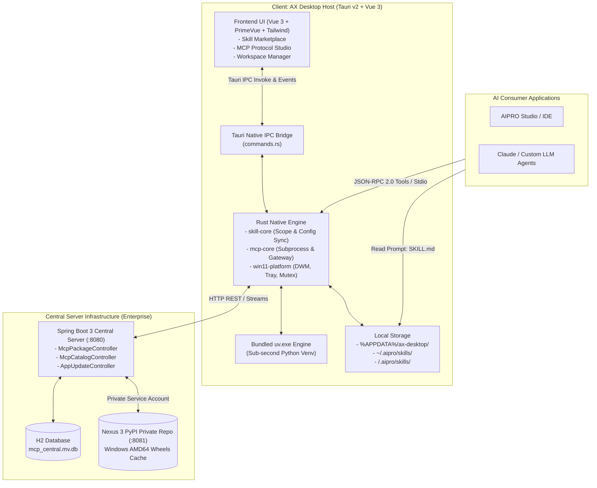
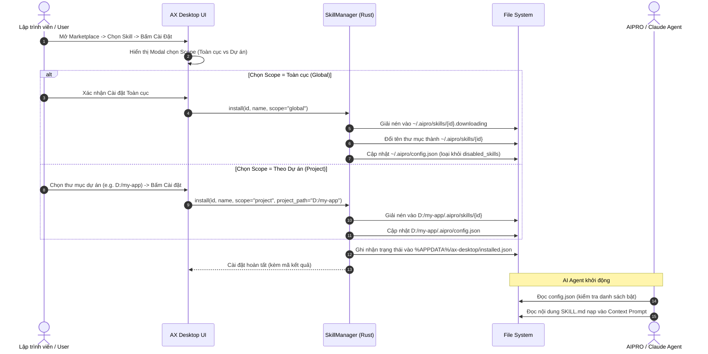
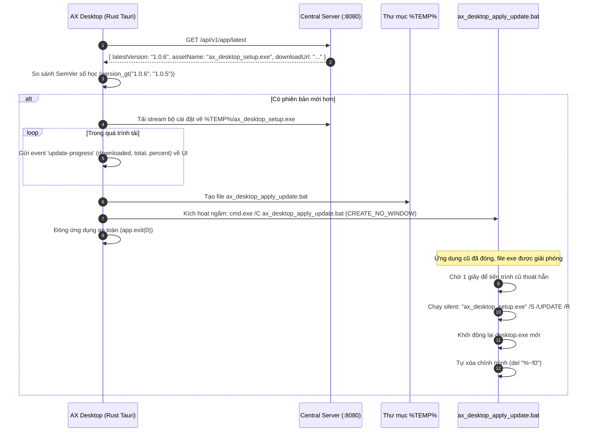

# TÀI LIỆU ĐẶC TẢ KỸ THUẬT & NGHIỆP VỤ TOÀN DIỆN HỆ THỐNG AX DESKTOP & MCP CENTRAL SERVER
## (AX System Master Specification for AI & Core Engineers)

> **Mục tiêu của tài liệu:** Cung cấp bức tranh toàn cảnh 100% đầy đủ, chi tiết, không bỏ sót bất kỳ tính năng, nghiệp vụ hay API nào của toàn bộ hệ sinh thái **AX Desktop** (Client Tauri v2 Native Rust + Vue 3) và **MCP Central Server** (Spring Boot 3 + Nexus Gateway). Bất kỳ AI Agent nào tiếp nhận tài liệu này đều có thể nắm bắt ngay cấu trúc kiến trúc, luồng dữ liệu, các ràng buộc kỹ thuật và tiếp tục phát triển, bảo trì hoặc mở rộng hệ thống một cách chuẩn xác nhất.

---

## MỤC LỤC TỔNG QUAN

1. [Tổng Quan Kiến Trúc Hệ Thống & Triết Lý Thiết Kế](#1-tổng-quan-kiến-trúc-hệ-thống--triết-lý-thiết-kế)
2. [Cấu Trúc Thư Mục & Tổ Chức Workspace](#2-cấu-trúc-thư-mục--tổ-chức-workspace)
3. [Phân Biệt Cốt Lõi: Track A (MCP Server) vs Track B (Agent Skill)](#3-phân-biệt-cốt-lõi-track-a-mcp-server-vs-track-b-agent-skill)
4. [Tính Năng 1: Xác Thực & Quản Trị Tài Khoản (Auth & Security)](#4-tính-năng-1-xác-thực--quản-trị-tài-khoản-auth--security)
5. [Tính Năng 2: Phân Hệ Quản Lý & Vận Hành AI Skill (Skill Marketplace)](#5-tính-năng-2-phân-hệ-quản-lý--vận-hành-ai-skill-skill-marketplace)
6. [Tính Năng 3: Phân Hệ MCP Protocol Studio & Gateway Server](#6-tính-năng-3-phân-hệ-mcp-protocol-studio--gateway-server)
7. [Tính Năng 4: Quản Lý Dự Án & Bộ Chọn Thư Mục Native (Workspace Management)](#7-tính-năng-4-quản-lý-dự-án--bộ-chọn-thư-mục-native-workspace-management)
8. [Tính Năng 5: Động Cơ Tự Động Cập Nhật Không Gián Đoạn (Silent Auto-Updater)](#8-tính-năng-5-động-cơ-tự-động-cập-nhật-không-gián-đoạn-silent-auto-updater)
9. [Tính Năng 6: Tối Ưu Nền Tảng Windows 11 & Giao Diện Chuẩn (Win11 Native Platform)](#9-tính-năng-6-tối-ưu-nền-tảng-windows-11--giao-diện-chuẩn-win11-native-platform)
10. [Tính Năng 7: Central Backend Server (Spring Boot 3 + Nexus Gateway)](#10-tính-năng-7-central-backend-server-spring-boot-3--nexus-gateway)
11. [Bảng Tra Cứu Toàn Bộ API Server (REST Endpoints)](#11-bảng-tra-cứu-toàn-bộ-api-server-rest-endpoints)
12. [Bảng Tra Cứu Toàn Bộ Tauri IPC Commands (Native Rust - Frontend Bridge)](#12-bảng-tra-cứu-toàn-bộ-tauri-ipc-commands-native-rust---frontend-bridge)
13. [Mô Hình Dữ Liệu & Lưu Trữ Cục Bộ (Local Storage & Schema)](#13-mô-hình-dữ-liệu--lưu-trữ-cục-bộ-local-storage--schema)
14. [Hướng Dẫn Biên Dịch, Kiểm Thử & Vận Hành (Developer Runbook)](#14-hướng-dẫn-biên-dịch-kiểm-thử--vận-hành-developer-runbook)

---

## 1. TỔNG QUAN KIẾN TRÚC HỆ THỐNG & TRIẾT LÝ THIẾT KẾ

Hệ sinh thái **AX Desktop** được thiết kế để giải quyết bài toán cốt lõi: **Cung cấp môi trường thực thi và quản lý tập trung cho các Agent AI (như AIPRO Studio, Claude Desktop, Cursor, v.v.) hoạt động trơn tru trong cả môi trường Online và Mạng nội bộ cách ly (Air-gapped / Offline Enterprise)**.



### Triết lý kiến trúc then chốt:
1. **Zero-Jank & High Performance**: Thay vì dùng Electron cồng kềnh (ngốn 300-500MB RAM), AX Desktop sử dụng **Tauri v2** biên dịch nhị phân gốc bằng **Rust 1.80+** và tận dụng runtime hệ điều hành **Microsoft Edge WebView2**. Ứng dụng chỉ tiêu tốn ~40-60MB RAM và khởi động tức thì (<200ms).
2. **Dual-Track Separation**: Tách bạch tuyệt đối giữa **MCP Servers** (các tiến trình chạy nền cung cấp công cụ tính toán qua JSON-RPC 2.0) và **AI Skills** (các tập chỉ dẫn hành vi, prompt ngữ cảnh và công cụ theo chuẩn `SKILL.md`).
3. **Air-Gapped First**: Không bao giờ phụ thuộc vào kết nối Internet công cộng khi cài đặt gói. Toàn bộ thư viện phụ thuộc Python (wheels `.whl`) được lưu trữ, kiểm duyệt tại Nexus 3 Server nội bộ và cài đặt bằng công cụ độc lập `uv.exe` trong vòng chưa đầy 1 giây.
4. **Resilient Local Persistence**: Mọi thao tác ghi file cấu hình đều dùng cơ chế **Atomic Write** (ghi vào file tạm rồi đổi tên) kết hợp cơ chế tự phục hồi, đảm bảo không bao giờ bị corrupt dữ liệu khi tắt máy đột ngột.

---

## 2. CẤU TRÚC THƯ MỤC & TỔ CHỨC WORKSPACE

Hệ thống được tổ chức thành 2 kho mã nguồn độc lập nhưng phối hợp chặt chẽ:

### 2.1. Client Host Repository (`D:\mcp-server-test`)
```text
D:\mcp-server-test/
├── apps/
│   └── desktop/                  # Tauri v2 Desktop Application Crate
│       ├── src/
│       │   ├── main.rs           # Hàm main khởi chạy tauri runtime
│       │   ├── lib.rs            # Single Instance Mutex, System Tray, DWM setup
│       │   └── commands.rs       # 25+ Tauri IPC commands kết nối Frontend với Rust
│       ├── tauri.conf.json       # Cấu hình cửa sổ, định danh, icons, CSP, bundle
│       └── Cargo.toml
├── bin/
│   └── uv.exe                    # Trình quản lý Python venv offline siêu tốc (Astral uv)
├── crates/
│   ├── shared-types/             # Struct dữ liệu chung, sinh code tự động sang TypeScript (ts-rs)
│   │   └── src/models.rs
│   ├── win11-platform/           # Tích hợp Windows 11 API (DWM Mica, Tray, Autostart, File locks)
│   │   └── src/
│   │       ├── single_instance.rs # Named Win32 Mutex AX_DESKTOP_SINGLE_INSTANCE_MUTEX
│   │       ├── dwm.rs             # DwmSetWindowAttribute dark titlebar
│   │       ├── autostart.rs       # Đọc/ghi Windows Registry Run key
│   │       ├── folder_picker.rs   # Hộp thoại chọn thư mục Windows Native
│   │       └── studio_launcher.rs # Khởi chạy AIPRO Studio IDE
│   ├── mcp-core/                 # Xử lý phân hệ MCP Protocol
│   │   └── src/
│   │       ├── catalog.rs         # Đọc, lọc và tìm kiếm danh mục MCP Server
│   │       ├── installer.rs       # Tạo môi trường ảo .venv, ghi file .env
│   │       └── mock_runner.rs     # Scanner và mock runner cho kiểm thử
│   └── skill-core/               # Xử lý phân hệ Agent Skill
│       └── src/
│           ├── skill_manager.rs   # Quản lý vòng đời Skill (Global/Project, Atomic Install, Toggle)
│           ├── synchronizer.rs    # Đọc SKILL.md, đồng bộ mảng disabled_skills vào config.json
│           ├── runtime_installer.rs # Tự động phát hiện uv.exe và dựng .venv cho Skill
│           ├── updater.rs         # So sánh SemVer, tải release, script cập nhật silent
│           └── storage.rs         # Atomic write/read, extract zip an toàn
├── frontend/                     # Giao diện người dùng Vue 3 SPA
│   ├── src/
│   │   ├── components/
│   │   │   ├── common/           # AppHeader, UpdateDialog, v.v.
│   │   │   └── ui/               # AxIcon (chuẩn hóa toàn bộ icon Lucide)
│   │   ├── features/
│   │   │   ├── auth/             # Login, Register OTP, Forgot Password OTP, Password Strength
│   │   │   ├── skills/           # Skill Marketplace, Detail Panel, Project List Panel
│   │   │   ├── plugins/          # MCP Studio, Server Detail, Import Git, Upload Zip
│   │   │   └── settings/         # Cài đặt ứng dụng, Theme, Autostart, Cập nhật
│   │   ├── i18n/                 # Đa ngôn ngữ (vi.json, en.json, ko.json)
│   │   ├── services/
│   │   │   └── nativeBridge.ts   # Adapter IPC giao tiếp 1:1 với Tauri Backend
│   │   └── types/generated/      # TypeScript interfaces được sinh từ Rust bằng ts-rs
│   ├── package.json
│   └── vite.config.ts
├── docs/                         # Tài liệu thiết kế & sơ đồ tương tác
│   └── architecture/
│       ├── AI_IMPLEMENTATION_BLUEPRINT.md
│       ├── project-backend-master-workflow.html # Sơ đồ tương tác Archify
│       └── project-backend-master-workflow.json
├── target/release/
│   └── desktop.exe               # Ứng dụng độc lập Windows x64 đã biên dịch
└── Cargo.toml                    # Cargo Workspace cấu hình chung
```

### 2.2. Central Server Repository (`D:\mcp-central-server`)
```text
D:\mcp-central-server/
├── src/main/java/com/company/mcp/
│   ├── controller/
│   │   ├── McpCatalogController.java     # GET /api/v1/mcp/packages, /catalog
│   │   ├── McpPackageController.java     # POST /upload, /import-git, GET /download, /wheels
│   │   └── AppUpdateController.java      # GET /api/v1/app/latest, /download
│   ├── service/
│   │   ├── PackageStorageService.java   # Lưu trữ gói zip, Anti-ZipSlip, SHA-256
│   │   ├── DependencyGatewayService.java# Proxy xác thực kéo .whl từ Nexus 3
│   │   └── CatalogSeedService.java      # Khởi tạo dữ liệu mẫu mặc định
│   ├── entity/                          # McpPackage, McpTool, McpEnvRequirement
│   ├── repository/                      # Spring Data JPA Repositories
│   └── dto/                             # Data Transfer Objects
├── data/
│   └── mcp_central.mv.db                # CSDL H2 nhúng lưu trữ siêu bền
├── storage/
│   ├── mcp-packages/                     # Thư mục chứa file ZIP mã nguồn
│   ├── wheels-cache/                     # Thư mục cache các gói wheels Windows
│   └── app-releases/                     # Thư mục lưu file cài đặt desktop.exe setup
├── pom.xml
└── run_server.bat                        # Script khởi chạy Spring Boot (:8080)
```

---

## 3. PHÂN BIỆT CỐT LÕI: TRACK A (MCP SERVER) VS TRACK B (AGENT SKILL)

Để AI tiếp tục phát triển mà không bị nhầm lẫn luồng xử lý, bảng sau phân định rõ bản chất của hai thành phần:

| Tiêu chí | Track A: MCP Server (Model Context Protocol) | Track B: Agent Skill (Anthropic / AIPRO Skill) |
| :--- | :--- | :--- |
| **Bản chất kỹ thuật** | **Background Service Process** chạy thường trực | **Prompt & Context Specification** nạp vào AI Model |
| **Giao thức liên lạc** | Giao thức JSON-RPC 2.0 qua `stdio`, `sse`, hoặc `http` | AI đọc trực tiếp file `SKILL.md` (System Prompt & Markdown) |
| **Vị trí lưu trữ** | Thư mục trạm `servers/{id}/` | **Global** (`~/.aipro/skills/{id}`) hoặc **Project** (`<project>/.aipro/skills/{id}`) |
| **Cách thức cấu hình** | File biến môi trường `.env`, Gateway HTTP port `8000` | File cấu hình JSON `.aipro/config.json` (mảng `disabled_skills`) |
| **Môi trường Python** | Luôn bắt buộc có Virtualenv `.venv` riêng và wheels | Chỉ tạo `.venv` khi Skill có chứa mã Python hoặc `requirements.txt` |
| **Vòng đời / Thoát** | Quản lý PID tiến trình con, Win32 `TerminateProcess` | Bật/Tắt (Toggle) qua config, Sao chép (`clone_skill`) giữa dự án |
| **Cách AI sử dụng** | Gọi hàm thông qua JSON Schema (e.g. `postgres_execute_query`)| Nạp quy tắc ứng xử, workflow phân tích vào cửa sổ ngữ cảnh |

---

## 4. TÍNH NĂNG 1: XÁC THỰC & QUẢN TRỊ TÀI KHOẢN (AUTH & SECURITY)

Phân hệ xác thực bảo vệ ứng dụng, hỗ trợ đăng nhập, đăng ký và quên mật khẩu thông qua mã OTP an toàn.

### 4.1. Quy trình Nghiệp vụ (Business Flows)
1. **Đăng nhập (Login)**:
   - Người dùng nhập Email (hoặc Username) và Mật khẩu.
   - Ứng dụng gọi lệnh `login`. Trả về đối tượng `AuthTokens` (gồm Access Token, Refresh Token và `AuthUser`).
   - Token được ghi an toàn nguyên tử (Atomic Write) vào `%APPDATA%\ax-desktop\auth.json`.
   - Nếu tích chọn *"Ghi nhớ đăng nhập"*, email sẽ được lưu vào `%APPDATA%\ax-desktop\settings.json` để tự động điền trong lần mở sau.
2. **Đăng ký tài khoản (Register with OTP)**:
   - Bước 1: Người dùng nhập Email -> Bấm gửi mã -> Gọi `request_register_otp(email)`.
   - Bước 2: Hệ thống gửi mã OTP 6 chữ số -> Người dùng nhập mã -> Gọi `verify_register_otp(email, otp)`.
   - Bước 3: Sau khi mã xác thực hợp lệ, người dùng nhập Họ tên và Mật khẩu -> Gọi `register(payload)` -> Tự động đăng nhập và lưu token.
3. **Quên / Đặt lại mật khẩu (Forgot Password)**:
   - Tương tự flow đăng ký: Gọi `request_forgot_otp` -> Gọi `verify_forgot_otp` -> Gọi `reset_password`.
4. **Đăng xuất (Logout)**:
   - Gọi lệnh `logout` -> Xóa file `auth.json` trên ổ đĩa -> Reset trạng thái Pinia store về `unauthenticated`.

### 4.2. Tính Năng UI/UX & Bảo Mật Native Bổ Sung
* **Thước đo độ mạnh mật khẩu (Password Strength Meter)**:
  - Tích hợp trực tiếp tại `RegisterScreen.vue`.
  - Đánh giá theo 4 tiêu chí chuẩn:
    1. Độ dài tối thiểu 8 ký tự.
    2. Chứa ít nhất một ký tự viết hoa (`A-Z`).
    3. Chứa ít nhất một chữ số (`0-9`).
    4. Chứa ít nhất một ký tự đặc biệt (`!@#$%^&*...`).
  - Hiển thị thanh tiến trình trực quan với 3 mức màu: Đỏ (Yếu), Vàng (Trung bình), Xanh ngọc (Mạnh).
* **Triệt tiêu xung đột Icon Con Mắt trên WebView2**:
  - Mặc định, engine Microsoft Edge WebView2 tự chèn icon con mắt xem mật khẩu (`::-ms-reveal`) và icon xóa text (`::-ms-clear`), gây hiện tượng 2 con mắt trùng lặp khi ứng dụng đã có nút toggle mật khẩu riêng.
  - Đã xử lý triệt để trong `frontend/src/assets/styles/main.css`:
    ```css
    input::-ms-reveal,
    input::-ms-clear {
      display: none !important;
    }
    ```

---

## 5. TÍNH NĂNG 2: PHÂN HỆ QUẢN LÝ & VẬN HÀNH AI SKILL (SKILL MARKETPLACE)

Phân hệ Skill chịu trách nhiệm cung cấp và phân phối các kỹ năng tác vụ cho AI Agent.



### 5.1. Hai Cấp Độ Quản Lý Phạm Vi (Scope Architecture)
1. **Toàn cục (`Global Scope`)**:
   - Thư mục cài đặt: `%USERPROFILE%\.aipro\skills\{id}\` (hoặc `~/.aipro/skills/{id}`).
   - File cấu hình trạng thái: `%USERPROFILE%\.aipro\config.json`.
   - Mọi dự án được mở bởi AIPRO Studio trên máy tính này đều tự động nạp các Skill toàn cục (trừ khi dự án đó chủ động vô hiệu hóa).
2. **Theo Dự án (`Project Scope`)**:
   - Thư mục cài đặt: `{project_path}\.aipro\skills\{id}\`.
   - File cấu hình trạng thái: `{project_path}\.aipro\config.json`.
   - Chỉ có hiệu lực duy nhất khi mở và thao tác trong thư mục dự án tương ứng. Đảm bảo tính độc lập và bảo mật tuyệt đối cho từng dự án khách hàng.

### 5.2. Các Cơ Chế Kỹ Thuật Nghiêm Ngặt
* **Cài đặt Nguyên tử (Atomic Installation)**:
  - Khi tải gói `.zip`, `SkillManager` giải nén vào thư mục tạm có hậu tố `{target_dir}.downloading`.
  - Chỉ khi toàn bộ file trong zip được giải nén thành công và kiểm tra an toàn, hệ thống mới tiến hành đổi tên (rename) sang thư mục đích `{target_dir}`. Nếu gặp sự cố mạng hoặc lỗi giữa chừng, thư mục tạm bị xóa sạch, bảo vệ thư mục thật không bị corrupt.
* **Cơ chế Bật / Tắt (Toggle) Thông Minh**:
  - Khi tắt một Skill, hệ thống **không xóa file trên đĩa**.
  - Thay vào đó, `SkillManager` đọc file `SKILL.md` để lấy định danh `name` của skill, sau đó ghi tên này vào mảng `disabled_skills` trong file `config.json`.
  - Agent AI khi khởi động sẽ đọc mảng `disabled_skills` để bỏ qua các skill bị tắt. Khi bật lại, tên skill được rút khỏi mảng này.
* **Tự Động Cấu Hình Môi Trường Ảo Python (`RuntimeInstaller`)**:
  - Nếu Skill tải về chứa các file thực thi Python (`*.py`) hoặc file định nghĩa thư viện `requirements.txt`, `RuntimeInstaller` sẽ tự động tìm kiếm `uv.exe` (đi kèm trong thư mục `bin/` hoặc biến môi trường `UV_BIN`).
  - Hệ thống tự động thực thi `uv.exe venv .venv` ngay bên trong thư mục của Skill đó, tạo ra môi trường Python cách ly độc lập hoàn toàn mà người dùng không cần phải cài đặt thủ công.
* **Sao Chép Kỹ Năng Giữa Các Dự Án (`clone_skill`)**:
  - Hỗ trợ nhân bản một Skill đang hoạt động ổn định từ `source_project_path` sang `target_project_path`.
  - Tự động sao chép toàn bộ thư mục và đồng bộ file cấu hình `config.json` của dự án đích.

---

## 6. TÍNH NĂNG 3: PHÂN HỆ MCP PROTOCOL STUDIO & GATEWAY SERVER

Phân hệ MCP Protocol Studio biến máy tính cục bộ thành một trạm trung chuyển (Gateway) hỗ trợ giao thức chuẩn **Model Context Protocol (MCP)** do Anthropic khởi xướng.

### 6.1. Nghiệp Vụ Quản Lý Máy Chủ MCP
* **Catalog Server**: Cung cấp danh mục các máy chủ công cụ mạnh mẽ:
  - `PostgreSQL Database Explorer`: Cho phép AI truy vấn DB trực tiếp, phân tích schema, giải thích truy vấn (`EXPLAIN`).
  - `Docker Runtime Inspector`: Quản lý container, stream stdout logs, điều khiển docker-compose.
  - `Puppeteer Automator`: Điều khiển trình duyệt headless Chrome, chụp ảnh màn hình trang web, tương tác DOM.
  - `Filesystem Advanced`, `Git Inspector`, v.v.
* **Cấu Hình Biến Môi Trường Trực Quan (`.env`)**:
  - Mỗi MCP Server có danh sách biến môi trường bắt buộc hoặc tùy chọn (ví dụ: `DATABASE_URL`, `PG_MAX_POOL`).
  - Người dùng cấu hình trực tiếp trên giao diện modal Studio.
  - `ClientInstaller` sẽ ghi các giá trị này vào file `.env` nằm trong thư mục của máy chủ đó trước khi khởi động.
* **Nạp Server Mới**:
  - **Tải lên file ZIP**: Quét cấu trúc file `manifest.json`, kiểm tra tính an toàn chống Zip-Slip, giải nén và đăng ký vào Studio.
  - **Nhập từ GitHub**: Nhập đường dẫn kho mã nguồn Git (kèm token nếu là repo riêng tư), server tự động clone/tải về và phân giải.

### 6.2. Cổng Gateway Cục Bộ (Local Gateway Port 8000)
* Rust Native Engine quản lý một máy chủ HTTP cục bộ tại địa chỉ `http://127.0.0.1:8000`.
* Định tuyến công cụ chuẩn hóa: `POST /mcp/tools/:tool_name`.
* Khi AI gửi yêu cầu thực thi:
  1. Gateway nhận HTTP request payload.
  2. Gateway tìm kiếm Subprocess tương ứng đang quản lý tool đó.
  3. Gửi câu lệnh theo chuẩn **JSON-RPC 2.0 (`tools/call`)** qua đường ống chuẩn `stdio` (hoặc SSE).
  4. Nhận kết quả từ `stdout` của Subprocess và trả lại HTTP response 200 cho AI.

### 6.3. Quản Lý Vòng Đời & Win32 File Lock Release
* Trên hệ điều hành Windows, các tiến trình Python hoặc file thư viện mở rộng `.pyd` đang hoạt động sẽ bị hệ điều hành khóa độc quyền (Exclusive File Lock). Nếu cố tình xóa thư mục khi tiến trình chưa thoát, hệ thống sẽ văng lỗi `OS Error 5: Access Denied`.
* **Giải pháp trong AX Desktop**:
  - `mcp-core` theo dõi chính xác PID của từng tiến trình con.
  - Khi người dùng bấm *Gỡ cài đặt (Uninstall)* hoặc *Tắt (Disable)*:
    1. Gửi tín hiệu đóng nhẹ nhàng (Graceful Exit).
    2. Chờ tối đa 3 giây. Nếu tiến trình chưa thoát, gọi API gốc Windows `win11_platform::terminate_process(pid)`.
    3. Sau khi tiến trình đã chấm dứt hoàn toàn, mới thực hiện giải phóng tài nguyên và xóa thư mục an toàn.

---

## 7. TÍNH NĂNG 4: QUẢN LÝ DỰ ÁN & BỘ CHỌN THƯ MỤC NATIVE (WORKSPACE MANAGEMENT)

Nhằm tối ưu hóa luồng làm việc thực tế của lập trình viên, AX Desktop tích hợp phân hệ quản lý Workspace độc lập:

### 7.1. Bố Cục Giao Diện Master Header
* **Vị trí góc trái Top Header**: Chứa **duy nhất** nút **`📁 Quản lý Dự án`** (kèm badge hiển thị số lượng dự án đã lưu).
  - Thay thế hoàn toàn cho logo văn bản tĩnh thừa thãi trước đây.
  - Khi bấm vào nút này, giao diện sẽ kích hoạt màn hình `ProjectListPanel.vue`.
* **Thanh Sub-bar (`h-10`)**: Hai nút điều hướng chính `Marketplace` và `Đã cài đặt` được đặt nằm ngay ngắn ở thanh sub-bar bên dưới (tương tự như thiết kế chuẩn bên MCP Protocol Studio), mang lại sự đối xứng, gọn gàng và không gây vỡ giao diện.

### 7.2. Hộp Thoại Chọn Thư Mục Windows Native (Native Folder Picker)
* Sử dụng lệnh Tauri IPC `select_folder`:
  - Gọi xuống crate `win11-platform` để kích hoạt hộp thoại chọn thư mục chuẩn của Windows (thông qua Shell COM Dialog hoặc `rfd`).
  - Tự động chuẩn hóa đường dẫn (chuẩn hóa dấu gạch chéo `/` tránh lỗi escape ký tự `\` trên Windows).
  - Trả về đối tượng `{ ok: true, path: "D:/my-project" }` hoặc `{ ok: false, cancelled: true }`.

### 7.3. Lưu Trữ Lịch Sử Dự Án
* Tự động lưu tối đa 8 dự án gần nhất vào `%APPDATA%\ax-desktop\settings.json`.
* Dự án mới chọn sẽ được tự động đưa lên đầu danh sách (MRU - Most Recently Used).
* Cung cấp nút xóa từng dự án khỏi danh sách lịch sử (`remove_recent_project`).

---

## 8. TÍNH NĂNG 5: ĐỘNG CƠ TỰ ĐỘNG CẬP NHẬT KHÔNG GIÁN ĐOẠN (SILENT AUTO-UPDATER)

AX Desktop sở hữu cơ chế tự nâng cấp phiên bản không làm phiền người dùng và không phụ thuộc vào các dịch vụ bên ngoài.



### 8.1. Thuật Toán So Sánh Phiên Bản (SemVer gt)
* Hàm `version_gt(a, b)` trong `skill-core/src/updater.rs`:
  - Phân tách phiên bản thành các phân đoạn số học nguyên thủy (`clean_version_segments`).
  - Hỗ trợ xử lý chuẩn xác mọi định dạng tag: `"1.10.0" > "1.2.0"`, `"v1.0.6"`, `"ax-desktop-v1.0.22"`.
  - Không bao giờ bị lỗi so sánh chuỗi thông thường (vốn coi `"1.10.0"` nhỏ hơn `"1.2.0"`).

### 8.2. Cập Nhật Silent & Khởi Động Lại
* Ứng dụng tải bộ cài đặt NSIS setup vào thư mục `%TEMP%`.
* Tạo file batch `ax_desktop_apply_update.bat` với cờ `/S` (Silent installation) và `/R` (Restart).
* Sử dụng cờ Win32 `CREATE_NO_WINDOW` (`0x08000000`) khi gọi `Command::new("cmd.exe")` để ngăn màn hình đen CMD nhấp nháy làm gián đoạn trải nghiệm người dùng.

---

## 9. TÍNH NĂNG 6: TỐI ƯU NỀN TẢNG WINDOWS 11 & GIAO DIỆN CHUẨN (WIN11 NATIVE PLATFORM)

Để đạt đẳng cấp trải nghiệm ứng dụng bản địa (Native Experience), AX Desktop triển khai trực tiếp các API hệ điều hành Windows:

### 9.1. Đảm Bảo Đơn Tiến Trình (Single Instance Named Mutex)
* Ngay tại dòng đầu tiên của `apps/desktop/src/lib.rs`, ứng dụng chiếm giữ một Win32 Named Mutex có tên:
  ```rust
  let _guard = win11_platform::single_instance::SingleInstanceGuard::acquire("AX_DESKTOP_SINGLE_INSTANCE_MUTEX");
  ```
* Nếu người dùng cố tình mở thêm một cửa sổ thứ hai, Mutex sẽ phát hiện xung đột và thoát ngay lập tức (`std::process::exit(0)`), tránh xung đột file cấu hình và trùng lặp cổng Gateway.

### 9.2. Tiêu Đề Cửa Sổ Chuẩn DWM Dark Titlebar
* Bằng cách gọi hàm API `DwmSetWindowAttribute` của thư viện `dwmapi.dll` với thuộc tính `DWMWA_USE_IMMERSIVE_DARK_MODE` (`attribute = 20` hoặc `19`), thanh tiêu đề Windows của AX Desktop sẽ đồng bộ màu sắc hoàn hảo theo theme Dark hoặc Light của ứng dụng, không bị thanh tiêu đề màu trắng chói mắt như các app thông thường.

### 9.3. Ẩn Xuống Khay Hệ Thống (Close-to-Tray Event Hook)
* Khi người dùng bấm nút `[X]` ở góc trên bên phải cửa sổ:
  - Sự kiện `tauri::WindowEvent::CloseRequested` bị chặn lại (`api.prevent_close()`).
  - Cửa sổ chính được ẩn đi (`window.hide()`).
  - Ứng dụng vẫn tiếp tục chạy ngầm trong System Tray.
* Menu System Tray gồm:
  - `Mở AX Desktop`: Hiển thị lại cửa sổ và đưa lên trên cùng (`show()`, `unminimize()`, `set_focus()`).
  - `Khởi động cùng Windows`: Bật/Tắt cấu hình tự chạy.
  - `Thoát ứng dụng`: Đóng hoàn toàn tiến trình (`app.exit(0)`).
* Bấm chuột trái vào Tray Icon cũng tự động kích hoạt hiển thị cửa sổ.

### 9.4. Tự Động Khởi Động Cùng Windows (Windows Registry Run Key)
* Thao tác trực tiếp với Registry Windows thông qua nhánh:
  `HKEY_CURRENT_USER\Software\Microsoft\Windows\CurrentVersion\Run`
* Tên khóa: `"AX Desktop"`, Giá trị: Đường dẫn tuyệt đối đến file thực thi `desktop.exe`.

### 9.5. Chuẩn Hóa 100% Hệ Thống Icon Lucide
* Đã gỡ bỏ toàn bộ icon cũ (PrimeIcons `pi pi-*` và file SVG IntelliJ).
* Toàn bộ hệ thống giao diện sử dụng component đồng nhất `<AxIcon name="..." size="..." />` bọc bộ icon hiện đại **Lucide Icons** (`lucide-vue-next`).

---

## 10. TÍNH NĂNG 7: CENTRAL BACKEND SERVER (SPRING BOOT 3 + NEXUS GATEWAY)

Central Server đóng vai trò là "trung tâm chỉ huy" lưu trữ, kiểm duyệt và phân phối gói cho mạng lưới doanh nghiệp.

### 10.1. Bảo Vệ An Toàn Chống Zip-Slip (Anti-ZipSlip Security)
* Khi người dùng upload bất kỳ file `.zip` nào lên endpoint `/api/v1/mcp/upload`, `PackageStorageService` tiến hành duyệt từng `ZipEntry`.
* Nếu phát hiện tên file chứa ký tự điều hướng thư mục cha (`..`) hoặc dấu phân cách bất thường có thể ghi đè ra ngoài thư mục `storage/mcp-packages/`, hệ thống lập tức ném ngoại lệ `SecurityException` và từ chối xử lý:
  ```java
  Path destPath = targetDir.resolve(entry.getName()).normalize();
  if (!destPath.startsWith(targetDir)) {
      throw new SecurityException("Zip-Slip exploit detected in entry: " + entry.getName());
  }
  ```

### 10.2. Dependency Gateway & Private Nexus Caching
* **Thách thức**: Các máy tính trong mạng nội bộ công ty (Air-gapped) không thể truy cập Internet để tải thư viện Python từ `pypi.org`.
* **Giải pháp**:
  1. Central Server lưu thông tin tài khoản Service Account bí mật kết nối tới **Nexus 3 Private Repository** (`http://nexus:8081`).
  2. Khi Desktop Client yêu cầu tải thư viện của gói `{id}` thông qua endpoint `/api/v1/mcp/packages/{id}/wheels`:
  3. Central Server kiểm tra thư mục cache `storage/wheels-cache/{id}-wheels.zip`.
  4. Nếu chưa có, server tự động truy vấn Nexus, kéo toàn bộ các file binary wheels tương thích Windows x64 (`*.whl`) về, đóng gói thành file `{id}-wheels.zip` và gửi về Client.
  5. Client giải nén và cài đặt nội bộ với lệnh:
     ```powershell
     uv pip install --no-index --find-links ./wheels -r requirements.txt
     ```
     Thời gian hoàn tất: **dưới 0.5 giây**, không cần 1 byte Internet ra ngoài.

---

## 11. BẢNG TRA CỨU TOÀN BỘ API SERVER (REST ENDPOINTS)

Dưới đây là đặc tả chi tiết toàn bộ các REST API được cung cấp bởi Central Java Server (`http://<server-ip>:8080`):

| HTTP Method | Endpoint URI | Headers / Query Params | Request Body | Response Format | Ý Nghĩa Nghiệp Vụ |
| :--- | :--- | :--- | :--- | :--- | :--- |
| **`GET`** | `/api/v1/catalog`<br>`/api/v1/mcp/packages` | `q` (tùy chọn): Từ khóa tìm kiếm<br>`category` (tùy chọn): Tên nhóm | *None* | `200 OK`<br>`CatalogResponse` (`{ total, servers: [...] }`) | Lấy danh mục tất cả MCP Servers và Skills đã được kiểm duyệt và lưu trữ trên server. |
| **`GET`** | `/api/v1/mcp/packages/{id}` | Path variable: `id` | *None* | `200 OK`<br>`PluginItemDto`<br>*(hoặc 404 Not Found)* | Lấy thông tin chi tiết của một package (metadata, danh sách tools, schema tham số, biến môi trường `.env`). |
| **`POST`** | `/api/v1/mcp/upload`<br>`/api/v1/packages/upload` | Multipart Form Data | `file`: File ZIP mã nguồn<br>`name`: Tên ghi đè (tùy chọn)<br>`description`: Mô tả ghi đè | `200 OK`<br>`{ status: "success", packageId, fileName, message }` | Upload gói mã nguồn MCP/Skill mới. Kiểm tra Anti-ZipSlip, verify manifest.json, tính SHA-256 và lưu CSDL. |
| **`POST`** | `/api/v1/mcp/import-git` | `Content-Type: application/json` | `GitImportRequest`<br>`{ repoUrl, branch, name, description, token }` | `200 OK`<br>`{ status: "success", packageId, fileName }` | Nhập mã nguồn trực tiếp từ GitHub / GitLab repo. Tự động đóng gói ZIP và tạo bản ghi metadata. |
| **`GET`** | `/api/v1/mcp/download/{fileName}`<br>`/api/v1/download/{fileName}` | Path variable: `fileName` | *None* | `200 OK`<br>`application/octet-stream` (Stream file ZIP) | Tải file ZIP mã nguồn của package về máy client (~20KB - 50KB). |
| **`GET`** | `/api/v1/mcp/packages/{id}/wheels`<br>`/api/v1/packages/{id}/wheels` | Path variable: `id` | *None* | `200 OK`<br>`application/octet-stream` (`{id}-wheels.zip`) | Tải gói wheels Windows x64 đã được Central Server kéo từ Nexus 3 và nén sẵn. |
| **`GET`** | `/api/v1/runtime/python` | *None* | *None* | `200 OK`<br>`application/octet-stream` (`python-embed-win64.zip`) | Tải bản phân phối Python nhúng độc lập (Portable Python Runtime) cho máy client chưa có Python. |
| **`DELETE`**| `/api/v1/mcp/packages/{id}` | Path variable: `id` | *None* | `200 OK`<br>`{ status: "success", packageId, storageDeleted }` | Xóa vĩnh viễn package khỏi Database và thanh lọc toàn bộ cache wheels trong storage. |
| **`GET`** | `/api/v1/app/latest` | *None* | *None* | `200 OK`<br>`AppUpdateDto`<br>`{ status, latestVersion, releaseName, assetName, downloadUrl }` | Kiểm tra phiên bản mới nhất của ứng dụng Desktop Client. |
| **`GET`** | `/api/v1/app/download` | *None* | *None* | `200 OK`<br>`application/octet-stream` (Stream file `.exe` setup) | Tải file installer cài đặt của bản Desktop mới nhất từ thư mục `storage/app-releases/`. |

---

## 12. BẢNG TRA CỨU TOÀN BỘ TAURI IPC COMMANDS (NATIVE RUST - FRONTEND BRIDGE)

Giao diện Vue 3 giao tiếp với Rust Native Backend thông qua 25+ lệnh gọi `invoke(...)`. Dưới đây là đặc tả toàn bộ các commands:

### 12.1. Nhóm Xác Thực & Tài Khoản (Auth Commands)
| Tên Command (IPC) | Tham số đầu vào (Args) | Dữ liệu trả về (Return Type) | Hành vi chi tiết |
| :--- | :--- | :--- | :--- |
| **`login`** | `payload: { email, password }` | `Result<{ ok: true, user: AuthUser }, String>` | Xác thực tài khoản, ghi `auth.json`, lưu `remembered_email` vào `settings.json` nếu có bật nhớ tài khoản. |
| **`request_register_otp`** | `email: String` | `Result<{ ok: true }, String>` | Yêu cầu gửi mã OTP đăng ký tới email chỉ định. |
| **`verify_register_otp`** | `email: String, otp: String` | `Result<{ ok: true }, String>` | Kiểm tra tính hợp lệ của mã OTP đăng ký. |
| **`register`** | `payload: { email, password, name }` | `Result<{ ok: true }, String>` | Tạo tài khoản mới, tự động đăng nhập và lưu token vào ổ đĩa. |
| **`request_forgot_otp`** | `email: String` | `Result<{ ok: true }, String>` | Yêu cầu gửi mã OTP khôi phục mật khẩu. |
| **`verify_forgot_otp`** | `email: String, otp: String` | `Result<{ ok: true }, String>` | Kiểm tra mã OTP khôi phục mật khẩu. |
| **`reset_password`** | `payload: { email, password }` | `Result<{ ok: true }, String>` | Đặt lại mật khẩu mới sau khi xác thực OTP thành công. |
| **`logout`** | *None* | `Result<{ ok: true }, String>` | Xóa file `auth.json`, đưa ứng dụng về trạng thái đăng xuất. |

### 12.2. Nhóm Trạng Thái & Kỹ Năng (Skill Commands)
| Tên Command (IPC) | Tham số đầu vào (Args) | Dữ liệu trả về (Return Type) | Hành vi chi tiết |
| :--- | :--- | :--- | :--- |
| **`get_status`** | *None* | `PortalStatus` | Đọc toàn bộ trạng thái hệ thống: đăng nhập, user, theme, danh sách skill đã cài, dự án gần đây. |
| **`fetch_skills`** | `query?: String, page?: usize, page_size?: usize` | `{ items: SkillItem[], totalCount: usize }` | Lấy danh sách kỹ năng trên Marketplace, tự động merge với trạng thái đã cài (`installed`, `enabled`) cục bộ. |
| **`get_skill_detail`** | `id: u64` | `Result<SkillDetail, String>` | Lấy thông tin chi tiết, metadata, markdown giới thiệu, danh sách công cụ và file của skill. |
| **`get_skill_versions`** | `id: u64` | `SkillVersionItem[]` | Lấy lịch sử các phiên bản phát hành của một skill. |
| **`install`** | `payload: { skill_id: u64, name?: String, version?: u32, scope?: String, project_path?: String }` | `Result<{ ok: true, code: String }, String>` | Tải zip, atomic extract, đồng bộ config.json, dựng venv nếu có Python, lưu `installed.json`. |
| **`uninstall`** | `payload: { skill_id: u64, scope?: String, project_path?: String }` | `Result<{ ok: true }, String>` | Xóa thư mục skill, xóa khỏi mảng `disabled_skills` và cập nhật `installed.json`. |
| **`toggle`** | `payload: { skill_id: u64, enabled: bool, scope?: String, project_path?: String }` | `Result<{ ok: true }, String>` | Bật/tắt skill bằng cách ghi/xóa tên skill khỏi mảng `disabled_skills` trong file `config.json`. |
| **`clone_skill`** | `payload: { skill_id: u64, name?: String, source_project_path: String, target_project_path: String }` | `Result<{ ok: true }, String>` | Sao chép thư mục skill từ dự án A sang dự án B và đồng bộ cấu hình dự án đích. |

### 12.3. Nhóm MCP Protocol Studio
| Tên Command (IPC) | Tham số đầu vào (Args) | Dữ liệu trả về (Return Type) | Hành vi chi tiết |
| :--- | :--- | :--- | :--- |
| **`get_catalog`** | `query?: String, category?: String` | `Result<CatalogResponse, String>` | Lấy danh sách các MCP Server từ Catalog file và các mock servers ngoại vi. |

### 12.4. Nhóm Tích Hợp Hệ Thống & Windows 11 (System Commands)
| Tên Command (IPC) | Tham số đầu vào (Args) | Dữ liệu trả về (Return Type) | Hành vi chi tiết |
| :--- | :--- | :--- | :--- |
| **`select_folder`** | *None* | `Result<{ ok: bool, path?: String, cancelled?: bool }, String>` | Kích hoạt hộp thoại Windows File Dialog để người dùng chọn thư mục dự án một cách trực quan. |
| **`save_recent_project`** | `path: String` | `Result<{ ok: true }, String>` | Chuẩn hóa đường dẫn và lưu vào danh sách lịch sử (tối đa 8 dự án). |
| **`remember_project_path`**| `path: String` | `Result<(), String>` | Alias của `save_recent_project`. |
| **`remove_recent_project`**| `path: String` | `Result<{ ok: true }, String>` | Xóa một dự án khỏi danh sách lịch sử gần đây. |
| **`set_theme`** | `theme: String` (`"dark"` hoặc `"light"`) | `Result<(), String>` | Cập nhật theme, lưu `settings.json` và gọi Win32 DWM đổi màu titlebar. |
| **`is_autostart_enabled`**| *None* | `bool` | Kiểm tra xem app có đang được đăng ký khởi động cùng Windows trong Registry không. |
| **`set_autostart`** | `enable: bool` | `Result<(), String>` | Thêm hoặc gỡ bỏ khóa `AX Desktop` trong Windows Registry `HKCU\.../Run`. |
| **`open_studio`** | *None* | `Result<{ ok: true }, String>` | Mở ứng dụng AIPRO Studio IDE tương ứng. |
| **`show_window`** | *None* | `Result<(), String>` | Đưa cửa sổ ứng dụng từ trạng thái ẩn/thu nhỏ lên màn hình chính. |
| **`get_app_info`** | *None* | `Value (name, version, platform, engine, mode)` | Lấy thông tin phiên bản nhị phân hiện tại của AX Desktop. |
| **`check_for_update`** | *None* | `Result<Value, String>` | Kiểm tra bản cập nhật mới từ Central Server hoặc GitHub Release. |
| **`download_and_install_update`** | `payload?: { download_url?: String }` | `Result<{ ok: true }, String>` | Stream tải installer, bắn event tiến trình, tạo batch script và thực hiện silent update. |

---

## 13. MÔ HÌNH DỮ LIỆU & LƯU TRỮ CỤC BỘ (LOCAL STORAGE & SCHEMA)

Hệ thống lưu trữ dữ liệu tại 3 vị trí trên máy tính người dùng:

### 13.1. Thư Mục Dữ Liệu Ứng Dụng: `%APPDATA%\ax-desktop\`
* **`auth.json`**:
  ```json
  {
    "accessToken": "eyJhbGciOi...",
    "refreshToken": "def5020...",
    "user": {
      "id": 1,
      "name": "Lê Viết Thắng",
      "email": "thang@aipro.studio",
      "avatar": null
    }
  }
  ```
* **`settings.json`**:
  ```json
  {
    "theme": "dark",
    "recentProjects": [
      "D:/projects/ecommerce-core",
      "D:/workspace/payment-service"
    ],
    "rememberedEmail": "thang@aipro.studio",
    "rememberAccount": true
  }
  ```
* **`installed.json`**:
  ```json
  [
    {
      "id": 101,
      "name": "vietnam-legal-advisor",
      "version": 1,
      "enabled": true,
      "installedAt": "2026-11-20T00:15:00Z",
      "scope": "global",
      "projectPath": null
    },
    {
      "id": 102,
      "name": "db-query-assistant",
      "version": 2,
      "enabled": false,
      "installedAt": "2026-11-20T00:20:00Z",
      "scope": "project",
      "projectPath": "D:/projects/ecommerce-core"
    }
  ]
  ```

### 13.2. Cấu Trình Trạng Thái Agent: `.aipro/config.json`
Nằm tại `%USERPROFILE%\.aipro\config.json` (Global) hoặc `<project_path>\.aipro\config.json` (Project):
```json
{
  "disabled_skills": [
    "db-query-assistant",
    "legacy-code-scanner"
  ]
}
```
> Khi một skill có tên nằm trong mảng `disabled_skills`, Agent AI sẽ tự động bỏ qua và không nạp hướng dẫn của skill đó vào prompt ngữ cảnh.

---

## 14. HƯỚNG DẪN BIÊN DỊCH, KIỂM THỬ & VẬN HÀNH (DEVELOPER RUNBOOK)

Bất kỳ AI Agent hoặc lập trình viên nào khi tiếp nhận dự án đều có thể sử dụng các lệnh dưới đây để vận hành:

### 14.1. Môi Trường Cần Thiết
* **Hệ điều hành**: Windows 10 / Windows 11 (64-bit).
* **Rust**: `1.80.0` trở lên (kèm `cargo`).
* **Node.js**: `v20.x` hoặc `v22.x` (kèm `npm`).
* **Java (cho Central Server)**: `JDK 17` hoặc `JDK 21`.
* **Maven**: `3.9+` (hoặc dùng `mvn.cmd` có sẵn).

### 14.2. Khởi Chạy Central Backend Server
```powershell
cd D:\mcp-central-server
# Khởi động Spring Boot chạy trên port 8080
.\run_server.bat
```
* Kiểm tra trạng thái server: `http://localhost:8080/api/v1/catalog`
* Chạy bộ kiểm thử E2E tự động:
  ```powershell
  powershell -ExecutionPolicy Bypass -File .\test_e2e_api.ps1
  ```

### 14.3. Phát Triển & Kiểm Thử AX Desktop Client
```powershell
cd D:\mcp-server-test

# 1. Chạy toàn bộ Unit Tests Frontend (47 vitest test cases)
npm --prefix frontend test

# 2. Kiểm tra biên dịch TypeScript Frontend
npm --prefix frontend run build

# 3. Chạy toàn bộ Unit & Integration Tests Backend Rust (46 cargo tests)
cargo test --workspace

# 4. Khởi chạy ứng dụng chế độ Development (Hot Reload)
npm --prefix frontend run tauri dev
```

### 14.4. Đóng Gói Bản Phát Hành (Release Build)
```powershell
cd D:\mcp-server-test

# Biên dịch ra file thực thi độc lập (Standalone Executable)
# File xuất ra tại: target/release/desktop.exe (~11 MB)
npm --prefix frontend run tauri build -- --no-bundle

# Biên dịch toàn bộ gói cài đặt NSIS Setup
# File xuất ra tại: target/release/bundle/nsis/ax_desktop_setup.exe
npm --prefix frontend run tauri build
```

---

## LỜI KẾT & CAM KẾT KIẾN TRÚC CHO AI PHÁT TRIỂN TIẾP THEO

Tài liệu này là **Nguồn Chân Lý Duy Nhất (Single Source of Truth)** của dự án AX Desktop. Khi phát triển thêm các tính năng mới:
1. **Luôn giữ chuẩn Lucide Icons qua `AxIcon.vue`**; tuyệt đối không đưa các icon thư viện khác vào để tránh xung đột phong cách.
2. **Luôn tuân thủ quy tắc Atomic Write** trong `crates/skill-core/src/storage.rs` khi thao tác với file cấu hình.
3. **Luôn giải phóng process Win32 (`TerminateProcess`)** trước khi xóa thư mục chứa file binary hoặc môi trường ảo Python.
4. **Bảo tồn tính năng cách ly Scope (Global vs Project)** để đảm bảo an toàn tuyệt đối cho các dự án khách hàng.
