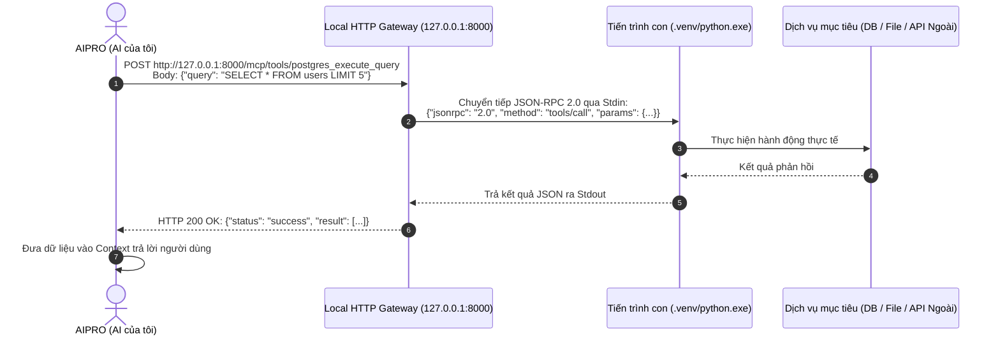

# Kịch Bản Kỹ Thuật Toàn Diện: Hệ Thống MCP Với Java Storage & Dependency Gateway

> **Mục tiêu:** Tài liệu hóa chi tiết kiến trúc chuẩn doanh nghiệp: **Java Backend Server** (Spring Boot) đóng vai trò là **Central Storage & Dependency Gateway** (kết nối Nexus Python nội bộ để quản lý và phân phối thư viện binary wheels cho máy client), kết hợp với **Desktop App Host** (Rust Tauri) vận hành **Local HTTP Gateway** (`http://127.0.0.1:8000`), phục vụ việc nạp gói (Upload ZIP & Import GitHub), cài đặt thư viện và thực thi công cụ cho **AIPRO (AI của tôi)**.

---

## 1. Sơ Đồ Kiến Trúc Hệ Thống Tổng Thể

Kiến trúc chuẩn hóa **duy nhất một mô hình tối ưu**: Máy Client **tuyệt đối không kết nối trực tiếp tới Nexus**, mà mọi yêu cầu cài đặt mã nguồn và thư viện đều thông qua **Java Server**.

```mermaid
flowchart TB
    subgraph INFRA ["HẠ TẦNG NỘI BỘ DOANH NGHIỆP & BÊN NGOÀI"]
        GitRepo["GitHub Repository<br/>(Public / Private Repo)"]
        NexusPy["Nexus Python Repository (Mạng bảo mật)<br/>(PyPI Proxy / Hosted Wheels nội bộ)"]
    end

    subgraph CENTRAL ["1. CENTRAL JAVA SERVER (SPRING BOOT - PORT 8080)"]
        direction TB
        JavaAPI["Java REST API Controllers<br/>├── POST /api/v1/mcp/upload (Upload ZIP code)<br/>├── POST /api/v1/mcp/import-git (Import GitHub URL)<br/>├── GET /api/v1/mcp/packages (Catalog)<br/>├── GET /api/v1/mcp/download/{id} (Tải ZIP code)<br/>└── GET /api/v1/mcp/packages/{id}/wheels (Tải ZIP wheels)"]
        
        NexusGateway["Nexus Dependency Gateway<br/>(Dùng Service Account kéo wheels từ Nexus)"]
        WheelsCache[("Thư mục Cache Wheels trên Server<br/>storage/wheels-cache/{id}-wheels.zip")]
        JavaDB[("Database: PostgreSQL / MySQL<br/>Lưu Metadata, Tools Schema")]
        CodeStorage[("Kho Gói Mã Nguồn<br/>storage/mcp-packages/{id}.zip")]

        JavaAPI <--> NexusGateway
        NexusGateway <--> WheelsCache
        JavaAPI <--> JavaDB
        JavaAPI <--> CodeStorage
    end

    subgraph DESKTOP ["2. LOCAL DESKTOP HOST (RUST TAURI - 127.0.0.1:8000)"]
        direction TB
        SyncClient["Java Client Communicator<br/>(Tải code & Tải wheels từ Java Server)"]
        LocalGateway["Local HTTP Gateway (Port 8000)<br/>├── POST /mcp/tools/:tool_name<br/>└── GET /sse"]
        RuntimeRunner["Môi Trường Ảo Riêng Biệt (.venv)<br/>(uv.exe pip install --no-index)"]
        
        SyncClient --> RuntimeRunner
        LocalGateway <--> RuntimeRunner
    end

    subgraph CLIENTS ["3. BÊN SỬ DỤNG CÔNG CỤ"]
        AIPRO["AIPRO (AI của tôi)<br/>(Gọi Tool qua HTTP POST hoặc SSE)"]
        WebUI["Web Frontend Studio<br/>(Quản lý Upload, Import GitHub, Cài đặt)"]
    end

    WebUI -->|1A. Upload ZIP code| JavaAPI
    WebUI -->|1B. Gửi URL GitHub để Import| JavaAPI
    JavaAPI -->|Fetch Zipball| GitRepo
    NexusGateway <-->|Kéo binary wheels nội bộ| NexusPy
    
    SyncClient -->|2A. Tải ZIP code ~20KB| JavaAPI
    SyncClient -->|2B. Tải ZIP wheels từ cache| JavaAPI
    
    AIPRO -->|3. Gọi Tool Cục Bộ (Độc lập mạng)| LocalGateway
    LocalGateway --> TargetServices[Cơ sở dữ liệu / Ổ cứng / API Ngoài]
```

---

## 2. Bảng Hợp Đồng API Chuẩn Hóa Trên Java Server

Máy chủ Java cung cấp các REST API sau để ứng dụng Desktop và Web Studio giao tiếp:

| Phương thức | Endpoint trên Java Server | Mô tả chức năng | Định dạng dữ liệu |
| :--- | :--- | :--- | :--- |
| **`POST`** | `/api/v1/mcp/upload` | Tiếp nhận file mã nguồn `.zip` tải lên, validate và lưu kho | `multipart/form-data` |
| **`POST`** | `/api/v1/mcp/import-git` | Nhận GitHub URL, tự clone/tải zipball, validate và đóng gói | `application/json` |
| **`GET`** | `/api/v1/mcp/packages` | Trả về danh mục tất cả MCP Server có trong kho | `application/json` |
| **`GET`** | `/api/v1/mcp/packages/{id}` | Lấy chi tiết thông tin và danh sách Tools của server | `application/json` |
| **`GET`** | `/api/v1/mcp/download/{id}` | Tải file `.zip` mã nguồn server về máy client (siêu nhẹ ~20KB) | `application/zip` (Stream) |
| **`GET`** | `/api/v1/mcp/packages/{id}/wheels`| Java Server lấy wheels từ Nexus đóng gói thành zip trả về client | `application/zip` (Stream) |
| **`DELETE`**| `/api/v1/mcp/packages/{id}` | Xóa gói mã nguồn và cache wheels trên Java Server (Server Purge) | `application/json` |
| **`POST`** | *(Local)* `http://127.0.0.1:8000/api/v1/client/uninstall/:id` | Gỡ cài đặt trên máy client: kill subprocess, xóa route & xóa .venv | `application/json` |

---

## 3. WORKFLOW 1: QUY TRÌNH NẠP GÓI LÊN JAVA SERVER (UPLOAD & GITHUB IMPORT)

Quy trình nạp gói hỗ trợ 2 hình thức: **Kéo thả File `.zip` mã nguồn** hoặc **Nhập URL GitHub Repository**:

```mermaid
sequenceDiagram
    autonumber
    actor Dev as Người dùng / Lập trình viên
    participant UI as Giao diện Web / Desktop
    participant Java as Java Server (Spring Boot)
    participant GitHub as GitHub API / Web (github.com)
    participant DB as Database (Postgres/MySQL)
    participant Disk as File Storage (Disk / S3)

    alt CÁCH 1A: UPLOAD FILE .ZIP MÃ NGUỒN TRỰC TIẾP
        Dev->>UI: Kéo thả file my-mcp-server.zip vào form
        UI->>Java: POST /api/v1/mcp/upload (MultipartFile file)
        
        rect rgb(25, 35, 55)
            Note over Java: Kiểm tra bảo mật & manifest
            Java->>Java: 1. Quét an toàn chống Zip-Slip (chặn '../')
            Java->>Java: 2. Kiểm tra tính hợp lệ của manifest.json
            Java->>Java: 3. Tính mã băm SHA-256
        end

        Java->>Disk: Lưu file mã nguồn vào: storage/mcp-packages/{id}.zip
        Java->>DB: Lưu bản ghi Metadata (id, name, version, tools_json, sha256)
        Java-->>UI: HTTP 201 Created: {"status": "success", "package_id": "postgres-mcp"}

    else CÁCH 1B: IMPORT TRỰC TIẾP TỪ GITHUB REPOSITORY URL
        Dev->>UI: Dán URL Repo: https://github.com/org/repo-mcp<br/>+ Nhập nhánh (mặc định 'main') + GitHub Token (nếu Private)
        UI->>Java: POST /api/v1/mcp/import-git<br/>Body: {"repoUrl": "...", "branch": "main", "token": "..."}
        
        rect rgb(30, 45, 65)
            Note over Java,GitHub: Tải mã nguồn từ GitHub
            Java->>GitHub: GET /repos/{owner}/{repo}/zipball/{branch}<br/>Header: Authorization: Bearer {token} (nếu có)
            GitHub-->>Java: Trả về luồng byte Zipball của Repository
            
            Note over Java: Xử lý đóng gói & kiểm tra an toàn
            Java->>Java: 1. Quét chống Zip-Slip trên luồng archive GitHub
            Java->>Java: 2. Tìm & Phân tích manifest.json trong repo gốc
            Java->>Java: 3. Đóng gói chuẩn hóa thành <repo-name>-<branch>.zip
            Java->>Java: 4. Tính toán mã băm SHA-256
        end

        Java->>Disk: Lưu file mã nguồn vào: storage/mcp-packages/{repo}-{branch}.zip
        Java->>DB: Ghi bản ghi gói MCP vào Database
        Java-->>UI: HTTP 201 Created: {"status": "success", "packageId": "repo-mcp"}
    end

    UI->>Dev: Thông báo: "Gói MCP đã sẵn sàng trên Kho Lưu Trữ Trung Tâm!"
```



---

## 4. WORKFLOW 2: CÀI ĐẶT MCP TẠI CLIENT QUA DEPENDENCY GATEWAY

Đây là quy trình chuẩn hóa: **Máy Client chỉ kết nối tới Java Server, hoàn toàn không cần kết nối trực tiếp tới Nexus**:

```mermaid
sequenceDiagram
    autonumber
    actor User as Người dùng / AIPRO
    participant Client as Desktop Client (Rust Host)
    participant Java as Java Server (Spring Boot)
    participant Nexus as Nexus Python (Mạng bảo mật)
    participant UV as bin/uv.exe (Local)
    participant LocalDir as Thư mục máy client (servers/<id>/)

    User->>Client: Bấm nút "Cài đặt" (Install) trên MCP Server <id>
    
    rect rgb(25, 35, 55)
        Note over Client,Java: BƯỚC 1: Tải mã nguồn MCP (Siêu nhẹ ~20 KB)
        Client->>Java: GET /api/v1/mcp/download/{id}
        Java-->>Client: Stream file code <id>.zip
        Client->>LocalDir: Giải nén luồng byte an toàn vào: servers/<id>/
        Client->>LocalDir: Ghi file cấu hình: servers/<id>/.env
    end

    rect rgb(30, 45, 65)
        Note over Client,Nexus: BƯỚC 2: Gọi API Java Server tải bộ Wheels từ Nexus
        Client->>Java: GET /api/v1/mcp/packages/{id}/wheels
        opt Nếu Java Server chưa cache bộ wheels của gói này
            Note over Java,Nexus: Java Server dùng Service Account nội bộ kéo từ Nexus
            Java->>Nexus: Kéo các file .whl chuẩn Windows (win_amd64) theo requirements.txt
            Nexus-->>Java: Trả về luồng nhị phân các file .whl
            Java->>Java: Đóng gói và lưu cache server: storage/wheels-cache/{id}-wheels.zip
        end
        Java-->>Client: Stream file {id}-wheels.zip về máy Client
        Client->>LocalDir: Giải nén vào thư mục: servers/<id>/wheels/
    end

    rect rgb(20, 30, 45)
        Note over Client,UV: BƯỚC 3: Dựng môi trường ảo độc lập bằng uv (100% Offline)
        Client->>UV: Thực thi: uv venv servers/<id>/.venv
        UV-->>LocalDir: Tạo máy ảo Python riêng (.venv/Scripts/python.exe)
        Client->>UV: Thực thi: uv pip install --no-index --find-links servers/<id>/wheels -r requirements.txt
        UV-->>LocalDir: Cài đặt tức thì từ thư mục wheels nội bộ (0.2s - 0.4s)
    end

    Client->>Client: Đăng ký các Tool của server <id> vào Local HTTP Gateway (Port 8000)
    Client-->>User: Đã kích hoạt xong (Ready)! AIPRO có thể gọi Tool ngay lập tức.
```



---

## 5. WORKFLOW 3: AIPRO GỌI TOOL QUA LOCAL HTTP GATEWAY (ĐỘC LẬP MẠNG)

Sau khi cài đặt xong, **AIPRO hoàn toàn không cần kết nối tới Java Server hay Nexus nữa**, mọi tương tác diễn ra cục bộ:



---

## 6. WORKFLOW 4: QUY TRÌNH UNINSTALL (GỠ CÀI ĐẶT MCP SERVER)

Khi người dùng quyết định **Gỡ cài đặt (Uninstall)** một MCP Server, hệ thống phân định rõ **2 cấp độ**:
1. **Cấp độ 1: Client Uninstall (Gỡ cài đặt khỏi máy trạm người dùng - Phổ biến nhất):** Giải phóng tài nguyên CPU/RAM, dọn sạch ổ cứng máy client, hủy đăng ký khỏi AIPRO, nhưng **vẫn giữ nguyên gói trên Java Server** để người dùng có thể cài đặt lại bất cứ lúc nào.
2. **Cấp độ 2: Server Purge (Xóa gói khỏi Java Server trung tâm):** Dành cho Quản trị viên/Tác giả muốn thu hồi gói vĩnh viễn khỏi kho chung của công ty.

---

### 6.1. Quy Trình Client Uninstall (4 Bước Kỹ Thuật Nghiêm Ngặt)

Trên hệ điều hành Windows, việc gỡ bỏ một MCP Server đang chạy nếu làm không đúng sẽ gây lỗi `Access is denied (OS Error 5)` do tiến trình Python khóa file (File Lock). Rust Host trên Desktop Client thực hiện 4 bước tuần tự:

```mermaid
sequenceDiagram
    autonumber
    actor User as Người dùng / AIPRO
    participant UI as Giao diện Web / Desktop
    participant Rust as Rust Host (Local Gateway Port 8000)
    participant Subprocess as Tiến trình con (.venv/python.exe)
    participant Disk as Ổ cứng cục bộ (servers/<id>/)
    participant AIPRO as AIPRO (AI của tôi)

    User->>UI: Bấm nút "Gỡ cài đặt" (Uninstall) server <id>
    UI->>Rust: POST http://127.0.0.1:8000/api/v1/client/uninstall/<id>

    rect rgb(35, 20, 20)
        Note over Rust,Subprocess: BƯỚC 1: Dừng tiến trình & Nhả Win32 File Locks
        opt Nếu MCP Server đang chạy (Subprocess Active)
            Rust->>Subprocess: Gửi tín hiệu đóng (Graceful Shutdown)
            alt Tiến trình kết thúc trong 3 giây
                Subprocess-->>Rust: Thoát bình thường (Exit Code 0)
            else Quá hạn (Timeout 3s)
                Rust->>Subprocess: Win32 TerminateProcess / Process.kill() (Force Kill)
            end
        end
    end

    rect rgb(35, 30, 20)
        Note over Rust,AIPRO: BƯỚC 2: Hủy đăng ký Tools khỏi Local HTTP Gateway
        Rust->>Rust: Xóa toàn bộ tools của <id> khỏi Route Table (HashMap)
        Note over AIPRO,Rust: Nếu AIPRO gọi Tool lúc này -> Trả về HTTP 404 Not Found ngay
    end

    rect rgb(25, 35, 55)
        Note over Rust,Disk: BƯỚC 3: Dọn dẹp ổ đĩa an toàn (Atomic File Cleanup)
        Rust->>Disk: Xóa thư mục: servers/<id>/ (.venv, wheels, .env, server.py)
        Disk-->>Rust: Đã xóa hoàn toàn, giải phóng 100% dung lượng đĩa
    end

    rect rgb(20, 35, 25)
        Note over Rust,UI: BƯỚC 4: Đồng bộ trạng thái giao diện người dùng
        Rust-->>UI: HTTP 200 OK: {"status": "uninstalled", "packageId": "<id>"}
        UI->>User: Cập nhật giao diện: Nút chuyển từ "Đã cài đặt" sang "Cài đặt"
    end
```



#### Chi Tiết 4 Bước Kỹ Thuật:
1. **Dừng Tiến Trình & Nhả Win32 File Lock:**
   * Rust Host kiểm tra xem tiến trình con (`python.exe`) của server có đang chạy không.
   * Nếu có, gửi tín hiệu ngắt và chờ tối đa 3 giây. Nếu không tắt thì gọi hàm Win32 API `TerminateProcess` ép dừng ngay lập tức. Bước này bắt buộc phải hoàn thành để Windows nhả toàn bộ Handle khóa các file `.dll`, `.pyd` và `.env` trong thư mục `.venv`.
2. **Hủy Đăng Ký Định Tuyến (Unregister Route Table):**
   * Xóa toàn bộ ánh xạ `POST /mcp/tools/<tool_name>` tương ứng với server `<id>` trong bộ nhớ của Local Gateway.
   * Nếu **AIPRO** cố gắng gọi tool sau thời điểm này, Gateway sẽ phản hồi ngay lập tức `HTTP 404: {"error": "Tool không tồn tại hoặc server đã bị gỡ cài đặt"}`.
3. **Xóa Sạch Thư Mục `servers/<id>/`:**
   * Sử dụng lệnh xóa thư mục đệ quy của Rust (`tokio::fs::remove_dir_all`).
   * Xóa trọn bộ: Môi trường ảo `.venv`, thư mục bánh xe `wheels/`, file mã nguồn `server.py`, file biến môi trường bí mật `.env`.
   * Dung lượng ổ cứng máy cá nhân được giải phóng hoàn toàn sạch sẽ.
4. **Cập Nhật Giao Diện:**
   * Phát sự kiện cập nhật trạng thái gói về `NOT_INSTALLED`.
   * Nút bấm trên giao diện chuyển thành **"Cài đặt" (Install)**. Khi người dùng cần dùng lại, chỉ việc bấm Install để Java Server cấp lại code và wheels.

---

### 6.2. Quy Trình Server Purge (Xóa Gói Khỏi Kho Java Server Trung Tâm)

Khi Quản trị viên (Admin) muốn xóa hoàn toàn gói khỏi kho lưu trữ tập trung của doanh nghiệp:

```mermaid
sequenceDiagram
    autonumber
    actor Admin as Quản Trị Viên / Tác Giả Gói
    participant UI as Giao diện Web Quản Trị
    participant Java as Java Server (Spring Boot)
    participant DB as Database (Postgres/MySQL)
    participant Storage as File Storage (Packages & Wheels Cache)

    Admin->>UI: Bấm "Xóa vĩnh viễn khỏi kho" (Delete Package)
    UI->>Java: DELETE /api/v1/mcp/packages/<id> (Kèm Admin Bearer Token)
    
    rect rgb(35, 20, 20)
        Note over Java,Storage: Dọn dẹp kho lưu trữ trung tâm
        Java->>Storage: Xóa file mã nguồn: storage/mcp-packages/<id>.zip
        Java->>Storage: Xóa file cache wheels: storage/wheels-cache/<id>-wheels.zip
        Java->>DB: Đánh dấu soft-delete hoặc xóa bản ghi Metadata
    end

    Java-->>UI: HTTP 200 OK: {"status": "success", "message": "Đã xóa gói khỏi kho trung tâm"}
    UI->>Admin: Thông báo thành công: Gói này sẽ không còn hiển thị trên danh mục Catalog của các Client khác
```



---

## 7. MÃ NGUỒN MẪU CONTROLLER TRÊN JAVA SERVER (SPRING BOOT)

Dưới đây là mã nguồn `McpPackageController.java` hoàn chỉnh, tích hợp trọn gói cả Upload, GitHub Import và Dependency Gateway kéo wheels từ Nexus:

```java
package com.company.mcp.controller;

import org.slf4j.Logger;
import org.slf4j.LoggerFactory;
import org.springframework.beans.factory.annotation.Value;
import org.springframework.core.io.Resource;
import org.springframework.core.io.UrlResource;
import org.springframework.http.HttpHeaders;
import org.springframework.http.MediaType;
import org.springframework.http.ResponseEntity;
import org.springframework.web.bind.annotation.*;
import org.springframework.web.multipart.MultipartFile;

import java.io.InputStream;
import java.net.URI;
import java.net.http.HttpClient;
import java.net.http.HttpRequest;
import java.net.http.HttpResponse;
import java.nio.file.*;
import java.util.HashMap;
import java.util.Map;
import java.util.regex.Matcher;
import java.util.regex.Pattern;
import java.util.zip.ZipEntry;
import java.util.zip.ZipInputStream;
import java.util.zip.ZipOutputStream;

@RestController
@RequestMapping("/api/v1/mcp")
@CrossOrigin(origins = "*")
public class McpPackageController {

    private static final Logger log = LoggerFactory.getLogger(McpPackageController.class);

    private final Path storageDir = Paths.get("storage/mcp-packages");
    private final Path wheelsCacheDir = Paths.get("storage/wheels-cache");

    @Value("${nexus.pypi.url:http://nexus.corp.local:8081/repository/pypi-all/simple}")
    private String nexusPypiUrl;

    private final HttpClient httpClient = HttpClient.newBuilder()
            .followRedirects(HttpClient.Redirect.ALWAYS)
            .build();

    public McpPackageController() throws Exception {
        Files.createDirectories(storageDir);
        Files.createDirectories(wheelsCacheDir);
    }

    // DTO tiếp nhận yêu cầu Import từ GitHub
    public record GitImportRequest(String repoUrl, String branch, String token) {}

    /**
     * API 1: Tiếp nhận Upload gói MCP ZIP mã nguồn từ Desktop App / Web UI
     */
    @PostMapping(value = "/upload", consumes = MediaType.MULTIPART_FORM_DATA_VALUE)
    public ResponseEntity<Map<String, Object>> uploadPackage(
            @RequestParam("file") MultipartFile file,
            @RequestParam(value = "name", required = false) String name) throws Exception {

        if (file.isEmpty() || !file.getOriginalFilename().endsWith(".zip")) {
            return ResponseEntity.badRequest().body(Map.of("error", "Chỉ chấp nhận file .zip"));
        }

        // 1. Kiểm tra an toàn chống Zip-Slip & đọc manifest.json
        boolean hasManifest = validateZipSafety(file.getInputStream());
        if (!hasManifest) {
            return ResponseEntity.badRequest().body(Map.of("error", "Gói zip thiếu file manifest.json"));
        }

        // 2. Lưu file mã nguồn vào kho
        String fileName = file.getOriginalFilename();
        Path targetPath = storageDir.resolve(fileName);
        Files.copy(file.getInputStream(), targetPath, StandardCopyOption.REPLACE_EXISTING);

        return ResponseEntity.ok(Map.of(
                "status", "success",
                "fileName", fileName,
                "message", "Upload gói MCP lên Java Server thành công"
        ));
    }

    /**
     * API 2: Import trực tiếp từ GitHub Repository URL
     */
    @PostMapping(value = "/import-git", consumes = MediaType.APPLICATION_JSON_VALUE)
    public ResponseEntity<Map<String, Object>> importFromGithub(@RequestBody GitImportRequest request) {
        try {
            if (request.repoUrl() == null || request.repoUrl().isBlank()) {
                return ResponseEntity.badRequest().body(Map.of("error", "URL GitHub không được để trống"));
            }

            // Phân tích cú pháp: github.com/:owner/:repo
            Pattern pattern = Pattern.compile("github\\.com/([^/]+)/([^/\\.]+)(\\.git)?");
            Matcher matcher = pattern.matcher(request.repoUrl());
            if (!matcher.find()) {
                return ResponseEntity.badRequest().body(Map.of("error", "Định dạng URL GitHub không hợp lệ"));
            }

            String owner = matcher.group(1);
            String repo = matcher.group(2);
            String branch = (request.branch() != null && !request.branch().isBlank()) ? request.branch() : "main";

            String zipUrl = String.format("https://github.com/%s/%s/archive/refs/heads/%s.zip", owner, repo, branch);
            HttpRequest.Builder reqBuilder = HttpRequest.newBuilder().uri(URI.create(zipUrl)).GET();
            if (request.token() != null && !request.token().isBlank()) {
                reqBuilder.header("Authorization", "Bearer " + request.token());
            }

            HttpResponse<InputStream> res = httpClient.send(reqBuilder.build(), HttpResponse.BodyHandlers.ofInputStream());
            if (res.statusCode() != 200) {
                return ResponseEntity.status(res.statusCode())
                        .body(Map.of("error", "GitHub trả về mã lỗi: " + res.statusCode()));
            }

            Path tempZip = Files.createTempFile("github_import_", ".zip");
            Files.copy(res.body(), tempZip, StandardCopyOption.REPLACE_EXISTING);

            boolean hasManifest;
            try (InputStream is = Files.newInputStream(tempZip)) {
                hasManifest = validateZipSafety(is);
            }

            if (!hasManifest) {
                Files.deleteIfExists(tempZip);
                return ResponseEntity.badRequest().body(Map.of("error", "Repo GitHub không chứa manifest.json hợp lệ"));
            }

            String targetFileName = String.format("%s-%s.zip", repo, branch);
            Files.move(tempZip, storageDir.resolve(targetFileName), StandardCopyOption.REPLACE_EXISTING);

            return ResponseEntity.ok(Map.of(
                    "status", "success",
                    "packageId", repo,
                    "fileName", targetFileName,
                    "message", "Import từ GitHub thành công!"
            ));
        } catch (Exception e) {
            return ResponseEntity.internalServerError().body(Map.of("error", e.getMessage()));
        }
    }

    /**
     * API 3: Cho phép Desktop App Download mã nguồn MCP ZIP về máy cục bộ (~20KB)
     */
    @GetMapping("/download/{fileName}")
    public ResponseEntity<Resource> downloadPackage(@PathVariable String fileName) throws Exception {
        if (!fileName.endsWith(".zip")) {
            fileName += ".zip";
        }
        Path filePath = storageDir.resolve(fileName).normalize();

        if (!Files.exists(filePath) || !filePath.startsWith(storageDir)) {
            return ResponseEntity.notFound().build();
        }

        Resource resource = new UrlResource(filePath.toUri());
        return ResponseEntity.ok()
                .contentType(MediaType.APPLICATION_OCTET_STREAM)
                .header(HttpHeaders.CONTENT_DISPOSITION, "attachment; filename=\"" + resource.getFilename() + "\"")
                .body(resource);
    }

    /**
     * API 4: DEPENDENCY GATEWAY - Client gọi API này để tải bộ Wheels từ Java Server
     * Java Server tự động kết nối Nexus Python để kéo wheels & đóng gói cho client!
     */
    @GetMapping("/packages/{id}/wheels")
    public ResponseEntity<Resource> downloadWheelsPackage(@PathVariable String id) throws Exception {
        Path wheelsZipPath = wheelsCacheDir.resolve(id + "-wheels.zip");

        // Nếu Server chưa có cache bộ wheels này, Server dùng kết nối Nexus để kéo về
        if (!Files.exists(wheelsZipPath)) {
            log.info("Chưa có cache wheels cho [{}]. Đang kết nối tới Nexus Python: {}", id, nexusPypiUrl);
            fetchAndBundleWheelsFromNexus(id, wheelsZipPath);
        }

        if (!Files.exists(wheelsZipPath)) {
            return ResponseEntity.notFound().build();
        }

        Resource resource = new UrlResource(wheelsZipPath.toUri());
        return ResponseEntity.ok()
                .contentType(MediaType.APPLICATION_OCTET_STREAM)
                .header(HttpHeaders.CONTENT_DISPOSITION, "attachment; filename=\"" + id + "-wheels.zip\"")
                .body(resource);
    }

    /**
     * API 5: Xóa gói MCP và cache wheels khỏi Java Server (Server Purge)
     */
    @DeleteMapping("/packages/{id}")
    public ResponseEntity<Map<String, Object>> deletePackage(@PathVariable String id) throws Exception {
        Path packageFile = storageDir.resolve(id + ".zip");
        Path wheelsFile = wheelsCacheDir.resolve(id + "-wheels.zip");

        boolean deletedPackage = Files.deleteIfExists(packageFile);
        boolean deletedWheels = Files.deleteIfExists(wheelsFile);

        log.info("Xóa gói MCP [{}]: packageDeleted={}, wheelsDeleted={}", id, deletedPackage, deletedWheels);

        return ResponseEntity.ok(Map.of(
                "status", "success",
                "packageId", id,
                "message", "Đã xóa gói mã nguồn và cache wheels khỏi Java Server"
        ));
    }

    /**
     * Hàm nội bộ: Java Server thực thi kéo wheels từ Nexus Python & đóng gói
     */
    private synchronized void fetchAndBundleWheelsFromNexus(String id, Path outputZip) {
        try {
            Path tempExtractDir = Files.createTempDirectory("mcp_wheels_" + id);
            
            // 1. Trích xuất file requirements.txt từ gói mã nguồn
            Path sourceZip = storageDir.resolve(id + ".zip");
            Path reqFile = tempExtractDir.resolve("requirements.txt");
            extractRequirementsFromZip(sourceZip, reqFile);

            // 2. Thực thi pip download trỏ tới Nexus Python nội bộ
            Path wheelsDownloadDir = tempExtractDir.resolve("wheels");
            Files.createDirectories(wheelsDownloadDir);

            ProcessBuilder pb = new ProcessBuilder(
                    "pip", "download",
                    "--index-url", nexusPypiUrl,
                    "-r", reqFile.toString(),
                    "-d", wheelsDownloadDir.toString(),
                    "--platform", "win_amd64",
                    "--only-binary=:all:"
            );
            pb.redirectErrorStream(true);
            Process process = pb.start();
            int exitCode = process.waitFor();

            if (exitCode == 0) {
                // 3. Nén toàn bộ file .whl thành file {id}-wheels.zip
                createZipFromDirectory(wheelsDownloadDir, outputZip);
                log.info("Đã đóng gói thành công wheels từ Nexus cho [{}]: {}", id, outputZip);
            } else {
                log.error("Lỗi khi pip download từ Nexus cho [{}], exitCode={}", id, exitCode);
            }
        } catch (Exception e) {
            log.error("Exception khi kéo wheels từ Nexus cho [{}]: {}", id, e.getMessage(), e);
        }
    }

    /**
     * Trích xuất file requirements.txt từ file zip mã nguồn
     */
    private void extractRequirementsFromZip(Path zipPath, Path targetReqFile) throws Exception {
        try (ZipInputStream zis = new ZipInputStream(Files.newInputStream(zipPath))) {
            ZipEntry entry;
            while ((entry = zis.getNextEntry()) != null) {
                if (entry.getName().endsWith("requirements.txt")) {
                    Files.copy(zis, targetReqFile, StandardCopyOption.REPLACE_EXISTING);
                    return;
                }
            }
        }
        // Nếu không có requirements.txt, tạo file trống
        Files.writeString(targetReqFile, "");
    }

    /**
     * Nén một thư mục thành file .zip
     */
    private void createZipFromDirectory(Path sourceDir, Path zipFile) throws Exception {
        try (ZipOutputStream zos = new ZipOutputStream(Files.newOutputStream(zipFile))) {
            try (var stream = Files.walk(sourceDir)) {
                stream.filter(path -> !Files.isDirectory(path)).forEach(path -> {
                    ZipEntry zipEntry = new ZipEntry(sourceDir.relativize(path).toString());
                    try {
                        zos.putNextEntry(zipEntry);
                        Files.copy(path, zos);
                        zos.closeEntry();
                    } catch (Exception e) {
                        throw new RuntimeException(e);
                    }
                });
            }
        }
    }

    /**
     * Kiểm tra an toàn Zip-Slip và kiểm tra manifest.json
     */
    private boolean validateZipSafety(InputStream is) throws Exception {
        boolean hasManifest = false;
        try (ZipInputStream zis = new ZipInputStream(is)) {
            ZipEntry entry;
            while ((entry = zis.getNextEntry()) != null) {
                if (entry.getName().contains("..") || entry.getName().startsWith("/")) {
                    throw new SecurityException("Phát hiện lỗ hổng Zip-Slip trong gói: " + entry.getName());
                }
                if (entry.getName().endsWith("manifest.json")) {
                    hasManifest = true;
                }
            }
        }
        return hasManifest;
    }
}
```

---

## 8. Tóm Tắt Lợi Ích Của Kiến Trúc Chuẩn Hóa Này

1. **Bảo Mật Vùng Mạng (Network Isolation / Zero-Trust):**
   * Máy chủ Nexus Python nằm ở vùng mạng an toàn nội bộ, tường lửa chặn toàn bộ truy cập từ máy trạm nhân viên.
   * Client chỉ cần duy nhất một kết nối tới cổng chuẩn của Java Server.
2. **Không Lo Lộ Thông Tin Xác Thực (Zero Credential Leak):**
   * Mật khẩu hoặc token của Nexus được cấu hình an toàn trên Java Server (`@Value("${nexus.pypi.url}")`). Máy Client hoàn toàn không nắm giữ tài khoản Nexus.
3. **Hiệu Suất Cực Cao Với Bộ Nhớ Đệm Tập Trung (Centralized Cache):**
   * Java Server chỉ cần kéo thư viện từ Nexus **một lần duy nhất**. Tất cả máy Client sau đó tải file `wheels.zip` từ cache nội bộ với tốc độ tối đa.
4. **Cài Đặt Tại Client Siêu Tốc (0.2s) & Chạy Độc Lập:**
   * Sau khi giải nén `wheels/`, lệnh `uv pip install --no-index` diễn ra trong chớp mắt.
   * **AIPRO (AI của tôi)** thực thi tool qua Local HTTP Gateway `127.0.0.1:8000` hoàn toàn mượt mà ngay cả khi ngắt kết nối mạng.
5. **Gỡ Cài Đặt (Uninstall) Sạch Sẽ, An Toàn:**
   * Nhả Win32 File Lock triệt để trước khi xóa, không để lại rác hay lỗi "Access Denied".
   * Tách bạch giữa gỡ cài đặt máy trạm (giải phóng ổ đĩa) và xóa vĩnh viễn trên kho trung tâm.
