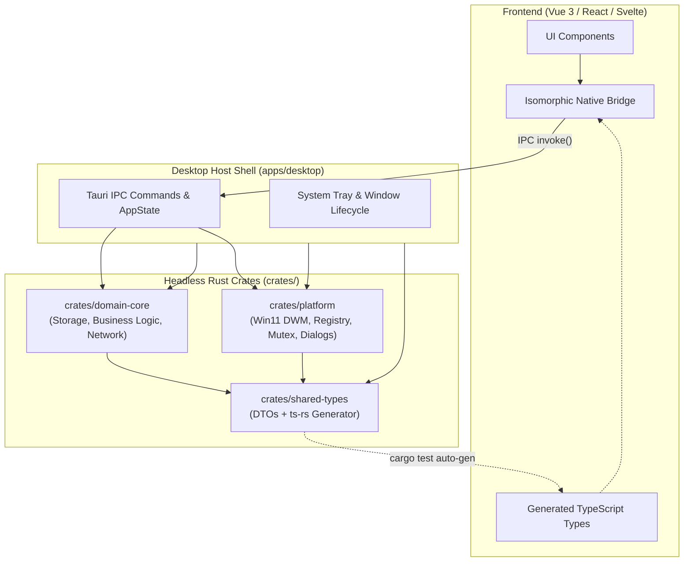

# Kiến trúc & Design Patterns: Phát triển Desktop App Chuẩn Mực với Rust & Tauri v2

> **Mục đích:** Tài liệu hóa toàn bộ kiến trúc, pattern thiết kế, giải pháp bảo mật và kỹ thuật tối ưu hóa từ dự án mẫu thành một bộ cẩm nang (Blueprint & Patterns) độc lập, có thể áp dụng ngay cho bất kỳ dự án Desktop App nào khác sử dụng **Rust** và **Tauri v2**.

---

## 1. Triết lý Kiến trúc Cốt lõi (Core Philosophy)

### 1.1 Headless-First (Tách rời hoàn toàn UI và Logic)
Một sai lầm phổ biến khi viết Tauri app là nhét logic nghiệp vụ (business logic) trực tiếp vào các hàm `#[tauri::command]` hoặc phụ thuộc chặt vào Tauri API runtime. 
* **Giải pháp chuẩn:** Tất cả core logic, storage, network, platform integration phải nằm trong các **Rust Crates độc lập** (Headless Library Crates).
* **Lợi ích:** 
  * Chạy test cực nhanh bằng `cargo test` mà không cần dựng webview hay Tauri runtime.
  * Có thể tái sử dụng core logic để viết CLI tool, background daemon, hoặc port sang framework khác trong tương lai.
  * Lớp `apps/desktop` (Tauri Shell) chỉ đóng vai trò là "máy chủ IPC mỏng" (thin IPC dispatcher).

### 1.2 Multi-Crate Workspace (Chia để trị)
Tổ chức dự án theo mô hình Cargo Workspace đa crate giúp:
* Giảm thời gian biên dịch nhờ cache riêng từng crate.
* Ranh giới trách nhiệm (Separation of Concerns) rõ ràng tuyệt đối.
* Tránh phụ thuộc chéo vòng tròn (cyclic dependencies).



---

## 2. Cấu trúc Cargo Workspace Mẫu (Template Layout)

```text
my-tauri-app/
├── Cargo.toml                    # Workspace root (quản lý dependencies dùng chung & profile release)
├── crates/
│   ├── shared-types/             # [Pure Data] Structs, DTOs, ts-rs derive để auto export TypeScript
│   ├── platform/                 # [OS-Specific] Win32 Mutex, Registry Autostart, DWM, File Dialog
│   └── app-core/                 # [Headless Core] Storage, Business Services, Updater, Mock Engine
├── apps/
│   └── desktop/                  # [Tauri Host] tauri.conf.json, main.rs, lib.rs, commands.rs
└── frontend/                     # [Client Web] TypeScript, UI components, nativeBridge.ts
    └── src/
        ├── types/generated/      # Thư mục chứa TypeScript types sinh tự động bởi Rust
        └── services/nativeBridge.ts # Cầu nối nhận diện môi trường (Mock vs Tauri)
```

### Cấu hình `Cargo.toml` gốc (Tối ưu hóa dung lượng & tốc độ build)
```toml
[workspace]
members = [
    "crates/shared-types",
    "crates/platform",
    "crates/app-core",
    "apps/desktop"
]
resolver = "2"

[workspace.dependencies]
serde = { version = "1.0", features = ["derive"] }
serde_json = "1.0"
tokio = { version = "1.0", features = ["full"] }
thiserror = "2.0"
ts-rs = { version = "10.1", features = ["serde-compat"] }
tauri = { version = "2.12" }

# Tối ưu dev profile: Tránh file .pdb khổng lồ hàng GB trên Windows
[profile.dev]
debug = 1

# Tối ưu release profile: Binary siêu nhẹ (< 5-10 MB), hiệu năng tối đa
[profile.release]
opt-level = 3
lto = true
codegen-units = 1
panic = "abort"
strip = true
```

---

## 3. Các Design Patterns Chi Tiết & Mã Nguồn Thực Tế

### Pattern 1: Contract-First Type Synchronization (`ts-rs`)
**Vấn đề:** Khi frontend và backend giao tiếp qua JSON IPC, sai lệch tên trường (`camelCase` vs `snake_case`) hoặc kiểu dữ liệu rất dễ gây bug ngầm.  
**Giải pháp:** Đặt Rust struct làm Single Source of Truth, dùng `ts-rs` để tự động xuất ra file `.ts` cho frontend mỗi khi chạy test hoặc build.

```rust
// crates/shared-types/src/models.rs
use serde::{Deserialize, Serialize};
use ts_rs::TS;

#[derive(Debug, Clone, Serialize, Deserialize, TS, PartialEq)]
#[serde(rename_all = "camelCase")] // Chuyển đổi chuẩn giữa snake_case (Rust) và camelCase (JS)
#[ts(export, export_to = "../../../frontend/src/types/generated/")]
pub struct UserProfile {
    pub id: String,
    pub username: String,
    pub email: String,
    #[serde(default)]
    #[ts(optional)]
    pub avatar_url: Option<String>,
    pub is_active: bool,
}
```

**Kích hoạt sinh Type tự động qua test:**
```rust
// crates/shared-types/src/lib.rs
#[cfg(test)]
mod tests {
    use super::models::*;
    use ts_rs::TS;

    #[test]
    fn export_typescript_bindings() {
        UserProfile::export().expect("Failed to export UserProfile type");
    }
}
```

---

### Pattern 2: Atomic File Storage & Rollback Protection
**Vấn đề:** Ứng dụng desktop có thể bị tắt đột ngột (mất điện, tắt máy, người dùng End Task). Ghi file trực tiếp sẽ làm hỏng dữ liệu (file 0 byte hoặc JSON dở dang). Ngoài ra, trên Windows, các tiến trình antivirus hoặc search indexer có thể lock file tạm thời gây lỗi `Access Denied`.

**Giải pháp:** 
1. Tạo backup `.bak` trước khi chỉnh sửa.
2. Ghi ra file `.tmp` trước và gọi `sync_all()`.
3. Rename file `.tmp` đè lên file chính với cơ chế **retry backoff** để vượt qua file-lock trên Windows.
4. Tự động phục hồi từ `.bak` nếu file chính bị lỗi format.

```rust
// crates/app-core/src/storage.rs
use serde::de::DeserializeOwned;
use serde::Serialize;
use std::fs::{self, File};
use std::io::{self, Write};
use std::path::{Path, PathBuf};
use thiserror::Error;

#[derive(Error, Debug)]
pub enum StorageError {
    #[error("IO error: {0}")]
    Io(#[from] io::Error),
    #[error("Serialization error: {0}")]
    Json(#[from] serde_json::Error),
}

/// Ghi atomic với retry xử lý Windows file-locks
pub fn write_json_atomic<T: Serialize>(path: &Path, value: &T) -> Result<(), StorageError> {
    if let Some(parent) = path.parent() {
        fs::create_dir_all(parent)?;
    }

    // 1. Tạo bản sao lưu dự phòng .bak
    let bak_path = PathBuf::from(format!("{}.bak", path.to_string_lossy()));
    if path.exists() {
        let _ = fs::copy(path, &bak_path);
    }

    // 2. Ghi ra file tạm .tmp
    let tmp_path = PathBuf::from(format!("{}.tmp", path.to_string_lossy()));
    {
        let mut file = File::create(&tmp_path)?;
        let json_data = serde_json::to_string_pretty(value)?;
        file.write_all(json_data.as_bytes())?;
        file.sync_all()?; // Đảm bảo dữ liệu đã flush xuống đĩa cứng vật lý
    }

    // 3. Rename nguyên tử với 5 lần thử (chống Windows locking)
    let mut last_err = None;
    for _ in 0..5 {
        match fs::rename(&tmp_path, path) {
            Ok(_) => {
                last_err = None;
                break;
            }
            Err(e) => {
                last_err = Some(e);
                std::thread::sleep(std::time::Duration::from_millis(50));
            }
        }
    }

    if let Some(e) = last_err {
        let _ = fs::copy(&tmp_path, path);
        let _ = fs::remove_file(&tmp_path);
        return Err(StorageError::Io(e));
    }

    Ok(())
}

/// Đọc an toàn với cơ chế fallback sang file .bak
pub fn read_json_safe<T: DeserializeOwned>(path: &Path) -> Option<T> {
    if path.exists() {
        if let Ok(content) = fs::read_to_string(path) {
            if let Ok(val) = serde_json::from_str::<T>(&content) {
                return Some(val);
            }
        }
    }

    // Fallback sang file .bak nếu file chính bị hỏng/trống
    let bak_path = PathBuf::from(format!("{}.bak", path.to_string_lossy()));
    if bak_path.exists() {
        if let Ok(content) = fs::read_to_string(&bak_path) {
            if let Ok(val) = serde_json::from_str::<T>(&content) {
                return Some(val);
            }
        }
    }

    None
}
```

---

### Pattern 3: Defense-in-Depth Safe Archive Extraction (Anti Zip-Slip)
**Vấn đề:** Khi tải plugin/gói zip từ internet hoặc user tải lên, kẻ tấn công có thể chèn file chứa path traversal như `../../../../Windows/System32/evil.dll` để ghi đè file hệ thống.  
**Giải pháp:** Kiểm tra 3 lớp (chuỗi thô, relative path, canonical path).

```rust
// crates/app-core/src/storage.rs
use std::io::Cursor;

pub fn extract_zip_safe(zip_bytes: &[u8], dest_dir: &Path) -> Result<(), StorageError> {
    fs::create_dir_all(dest_dir)?;
    let canonical_dest = fs::canonicalize(dest_dir)?;
    let mut archive = zip::ZipArchive::new(Cursor::new(zip_bytes))
        .map_err(|e| io::Error::new(io::ErrorKind::InvalidData, e))?;

    for i in 0..archive.len() {
        let mut file = archive.by_index(i)
            .map_err(|e| io::Error::new(io::ErrorKind::InvalidData, e))?;
        let raw_name = file.name().replace('\\', "/");

        // Lớp 1: Chặn ngay nếu chứa .. hoặc bắt đầu bằng root / drive prefix
        if raw_name.contains("..") || raw_name.starts_with('/') 
            || (raw_name.len() > 1 && raw_name.chars().nth(1) == Some(':')) {
            return Err(io::Error::new(io::ErrorKind::PermissionDenied, "Zip-slip detected!").into());
        }

        let outpath = dest_dir.join(&raw_name);

        if file.is_dir() {
            fs::create_dir_all(&outpath)?;
        } else {
            if let Some(p) = outpath.parent() {
                fs::create_dir_all(p)?;
            }
            let mut outfile = File::create(&outpath)?;
            io::copy(&mut file, &mut outfile)?;

            // Lớp 2: Kiểm tra đường dẫn phân giải thực tế (canonicalize)
            let canonical_out = fs::canonicalize(&outpath).unwrap_or_else(|_| outpath.clone());
            if !canonical_out.starts_with(&canonical_dest) {
                let _ = fs::remove_file(&outpath);
                return Err(io::Error::new(io::ErrorKind::PermissionDenied, "Zip-slip detected!").into());
            }
        }
    }
    Ok(())
}
```

---

### Pattern 4: Windows Platform Integration Cấp Thấp

#### A. Single Instance Named Mutex (Chống mở nhiều cửa sổ)
Dùng Win32 Named Mutex cấp kernel để bảo đảm app chỉ mở 1 instance duy nhất mà không phụ thuộc file lock tạm thời.

```rust
// crates/platform/src/single_instance.rs
#[cfg(target_os = "windows")]
pub struct SingleInstanceGuard {
    handle: windows_sys::Win32::Foundation::HANDLE,
}

#[cfg(target_os = "windows")]
impl SingleInstanceGuard {
    pub fn acquire(mutex_name: &str) -> Result<Self, ()> {
        use std::ffi::OsStr;
        use std::os::windows::ffi::OsStrExt;
        use windows_sys::Win32::Foundation::GetLastError;
        use windows_sys::Win32::System::Threading::CreateMutexW;

        let wide: Vec<u16> = OsStr::new(mutex_name).encode_wide().chain(Some(0)).collect();
        unsafe {
            let handle = CreateMutexW(std::ptr::null(), 1, wide.as_ptr());
            if handle == 0 || GetLastError() == 183 { // ERROR_ALREADY_EXISTS = 183
                return Err(());
            }
            Ok(Self { handle })
        }
    }
}

#[cfg(target_os = "windows")]
impl Drop for SingleInstanceGuard {
    fn drop(&mut self) {
        unsafe {
            windows_sys::Win32::System::Threading::ReleaseMutex(self.handle);
            windows_sys::Win32::Foundation::CloseHandle(self.handle);
        }
    }
}
```

#### B. Khởi động cùng Windows qua Registry (Không cần quyền Admin)
Ghi trực tiếp vào `HKEY_CURRENT_USER\Software\Microsoft\Windows\CurrentVersion\Run`.

```rust
// crates/platform/src/autostart.rs
#[cfg(target_os = "windows")]
use winreg::enums::*;
#[cfg(target_os = "windows")]
use winreg::RegKey;

pub fn set_run_at_startup(app_name: &str, enable: bool) -> Result<(), std::io::Error> {
    #[cfg(target_os = "windows")]
    {
        let hkcu = RegKey::predef(HKEY_CURRENT_USER);
        let path = r"Software\Microsoft\Windows\CurrentVersion\Run";
        let (key, _) = hkcu.create_subkey(path)?;

        if enable {
            let exe_path = std::env::current_exe()?;
            key.set_value(app_name, &exe_path.to_string_lossy().as_ref())?;
        } else {
            let _ = key.delete_value(app_name);
        }
    }
    Ok(())
}
```

#### C. Hộp thoại File/Folder Windows 11 Hiện Đại (Loại bỏ cửa sổ console đen)
Khi cần mở hộp thoại chọn folder trên Windows, nếu gọi command line powershell trực tiếp sẽ bị nháy cửa sổ console đen. Ta ẩn hoàn toàn cửa sổ này bằng cờ `CREATE_NO_WINDOW`:

```rust
// crates/platform/src/folder_picker.rs
use std::os::windows::process::CommandExt;
use std::process::Command;

pub fn pick_folder(initial_dir: Option<&str>) -> Option<String> {
    const CREATE_NO_WINDOW: u32 = 0x08000000;
    let init_script = initial_dir
        .map(|d| format!("-InitialDirectory '{}'", d.replace('\'', "''")))
        .unwrap_or_default();

    let ps_script = format!(
        "Add-Type -AssemblyName System.Windows.Forms; \
         $f = New-Object System.Windows.Forms.FolderBrowserDialog; \
         $f.ShowNewFolderButton = $true; \
         {} \
         if ($f.ShowDialog() -eq [System.Windows.Forms.DialogResult]::OK) {{ \
             [Console]::Write($f.SelectedPath) \
         }}",
        init_script
    );

    let output = Command::new("powershell")
        .args(["-NoProfile", "-NonInteractive", "-Command", &ps_script])
        .creation_flags(CREATE_NO_WINDOW) // Triệt tiêu console popup
        .output()
        .ok()?;

    let selected = String::from_utf8_lossy(&output.stdout).trim().to_string();
    if selected.is_empty() { None } else { Some(selected) }
}
```

---

### Pattern 5: Tauri v2 App State & Lifecycle Interceptor
Cách kết nối AppState trung tâm, cấu hình System Tray và biến nút Close `[X]` thành **Close-to-Tray**:

```rust
// apps/desktop/src/lib.rs
pub mod commands;
use commands::AppState;
use tauri::menu::{Menu, MenuItem};
use tauri::tray::{MouseButton, MouseButtonState, TrayIconBuilder, TrayIconEvent};
use tauri::Manager;

pub fn run() {
    // 1. Kiểm tra Single Instance
    let _guard = platform::single_instance::SingleInstanceGuard::acquire("MY_APP_MUTEX")
        .expect("Ứng dụng đã đang chạy!");

    tauri::Builder::default()
        .setup(|app| {
            // 2. Quản lý State tập trung (Dependency Injection)
            app.manage(AppState::new());

            // 3. Khởi tạo Tray Menu
            let show = MenuItem::with_id(app, "show", "Mở ứng dụng", true, None::<&str>)?;
            let quit = MenuItem::with_id(app, "quit", "Thoát hoàn toàn", true, None::<&str>)?;
            let menu = Menu::with_items(app, &[&show, &quit])?;

            if let Some(icon) = app.default_window_icon() {
                let _tray = TrayIconBuilder::new()
                    .icon(icon.clone())
                    .menu(&menu)
                    .show_menu_on_left_click(false)
                    .on_tray_icon_event(|tray, event| {
                        if let TrayIconEvent::Click { button: MouseButton::Left, button_state: MouseButtonState::Up, .. } = event {
                            if let Some(w) = tray.app_handle().get_webview_window("main") {
                                let _ = w.show();
                                let _ = w.unminimize();
                                let _ = w.set_focus();
                            }
                        }
                    })
                    .build(app)?;
            }

            // 4. Hook Window Close Event -> Hide to Tray
            if let Some(window) = app.get_webview_window("main") {
                let win_clone = window.clone();
                window.on_window_event(move |event| {
                    if let tauri::WindowEvent::CloseRequested { api, .. } = event {
                        api.prevent_close(); // Chặn đóng tiến trình
                        let _ = win_clone.hide(); // Ẩn xuống khay hệ thống
                    }
                });
            }
            Ok(())
        })
        .invoke_handler(tauri::generate_handler![
            commands::get_user_profile,
            commands::save_settings,
        ])
        .run(tauri::generate_context!())
        .expect("Lỗi chạy Tauri runtime");
}
```

---

### Pattern 6: Isomorphic Native Bridge (Frontend Abstraction)
**Vấn đề:** Trong quá trình phát triển frontend (Vite dev server), việc mỗi lần sửa UI đều phải mở qua Tauri app khiến việc phát triển chậm chạp, khó test trên browser thường.  
**Giải pháp:** Tạo một lớp bọc `nativeBridge.ts`. Lớp này kiểm tra sự tồn tại của Tauri (`window.__TAURI_INTERNALS__`). Nếu chạy trong Tauri, gọi `invoke()`; nếu chạy trong trình duyệt, gọi mock data hoặc REST API tương ứng.

```typescript
// frontend/src/services/nativeBridge.ts
import type { UserProfile } from '@/types/generated/UserProfile'

export function isTauriEnvironment(): boolean {
  return typeof window !== 'undefined' && '__TAURI_INTERNALS__' in window
}

export const nativeBridge = {
  async getUserProfile(): Promise<UserProfile> {
    if (isTauriEnvironment()) {
      // 1. Chạy trong Tauri Host -> Gọi IPC
      const { invoke } = await import('@tauri-apps/api/core')
      return await invoke<UserProfile>('get_user_profile')
    } else {
      // 2. Chạy trên Browser bình thường -> Fallback Mock/Http
      console.warn('[Bridge] Đang chạy trên browser: Sử dụng dữ liệu Mock')
      return {
        id: 'mock-001',
        username: 'dev_user',
        email: 'dev@local.mock',
        isActive: true,
      }
    }
  },
}
```

---

## 4. Tự Động Hóa Build & Đóng Gói (Zero Overhead Scripts)

Script đóng gói Windows Installer tự động dọn dẹp debug cache khổng lồ (thường chiếm 5-15GB `target/debug`):

```bat
:: build_installer.bat
@echo off
echo [1/3] Building Frontend Assets...
cd frontend
call npm run build
if %errorlevel% neq 0 exit /b %errorlevel%
cd ..

echo [2/3] Building Tauri Native NSIS Installer (Release)...
call cargo tauri build
if %errorlevel% neq 0 exit /b %errorlevel%

echo [3/3] Cleaning up heavy debug artifacts...
rmdir /s /q target\debug >nul 2>&1
echo Done! Bộ cài hoàn tất tại: target\release\bundle\nsis\
```

---

## 5. Checklist Áp Dụng Cho Dự Án Mới

| Bước | Hạng mục thực hiện | Mục tiêu chất lượng |
| :--- | :--- | :--- |
| **1** | Khởi tạo Cargo Workspace theo mô hình `crates/*` và `apps/*` | Tách biệt hoàn toàn Core Logic khỏi Tauri Shell |
| **2** | Cấu hình `[profile.release]` với `lto = true`, `opt-level = 3`, `strip = true` | Đảm bảo file cài đặt nhỏ nhẹ (< 10MB) |
| **3** | Tạo crate `shared-types` với `ts-rs` derive | Frontend & Backend đồng bộ type 100% tự động |
| **4** | Áp dụng `write_json_atomic` và `read_json_safe` | Chống hỏng hóc file dữ liệu khi crash/mất điện |
| **5** | Đặt `extract_zip_safe` khi nhận file zip | Triệt tiêu lỗ hổng bảo mật Zip-Slip |
| **6** | Thiết lập Single Instance Mutex & Close-to-Tray | Trải nghiệm desktop nguyên bản Windows 11 chuẩn mực |
| **7** | Viết `nativeBridge.ts` cho frontend | Tốc độ dev giao diện nhanh gấp 3 lần với mock fallback |
| **8** | Thiết lập môi trường phát triển & đóng gói Offline | Xem chi tiết tại [Cẩm nang Offline & Air-Gapped](./offline-airgapped-rust-tauri-guide.md) |
