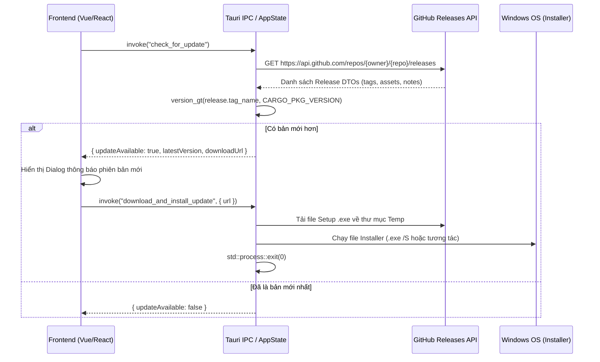

# Kỹ Thuật Chuyên Sâu: Tự Động Cập Nhật Qua GitHub Releases & Khởi Động Cùng Windows

> **Mục tiêu:** Tài liệu hóa chi tiết kiến trúc, thuật toán, mã nguồn thực tế và các phương án triển khai cho 2 tính năng sống còn của ứng dụng Desktop:
> 1. **Kiểm tra và Tự động Cập nhật phiên bản từ GitHub Releases API** (Không cần server riêng, chống lỗi so sánh phiên bản, hỗ trợ tải và cài đặt trực tiếp).
> 2. **Khởi động cùng hệ điều hành Windows (Autostart)** (Ghi Registry HKCU không cần quyền Admin, kỹ thuật khởi động ẩn xuống System Tray, tích hợp UI Toggle).

---

## PHẦN 1: TỰ ĐỘNG CẬP NHẬT TỪ GITHUB RELEASES (AUTO-UPDATER)

### 1.1 Kiến Trúc Tổng Quan



---

### 1.2 Thuật Toán So Sánh Phiên Bản Số Học An Toàn (`version_gt`)

**Cạm bẫy thường gặp:** So sánh chuỗi ký tự (String comparison) sẽ dẫn đến lỗi logic nghiêm trọng: chuỗi `"1.2.0"` lại lớn hơn `"1.10.0"` vì ký tự `'2'` > `'1'`. Ngoài ra tag của GitHub thường có tiền tố như `v1.0.0` hoặc `app-name-v1.0.0`.

**Giải pháp chuẩn:** Phân tách phiên bản thành các mảng số nguyên `Vec<u64>` và so sánh từng phân đoạn:

```rust
// crates/app-core/src/updater.rs

/// Làm sạch chuỗi và phân tách thành mảng số: "v1.10.2" -> vec![1, 10, 2]
fn clean_version_segments(v: &str) -> Vec<u64> {
    let cleaned = v
        .trim()
        .trim_start_matches("my-app-") // Tùy biến theo tiền tố app (nếu có)
        .trim_start_matches('v');

    cleaned
        .split('.')
        .map(|seg| {
            // Lấy các ký tự số đầu tiên (xử lý cả dạng 1.0.0-beta1)
            let digits: String = seg.chars().take_while(|c| c.is_ascii_digit()).collect();
            digits.parse::<u64>().unwrap_or(0)
        })
        .collect()
}

/// So sánh 2 chuỗi phiên bản: Trả về true nếu a > b
/// Hỗ trợ chuẩn xác: "1.10.0" > "1.2.0", "v2.0.1" > "v2.0.0"
pub fn version_gt(a: &str, b: &str) -> bool {
    let segs_a = clean_version_segments(a);
    let segs_b = clean_version_segments(b);

    let max_len = segs_a.len().max(segs_b.len());
    for i in 0..max_len {
        let val_a = segs_a.get(i).copied().unwrap_or(0);
        let val_b = segs_b.get(i).copied().unwrap_or(0);
        if val_a > val_b {
            return true;
        } else if val_a < val_b {
            return false;
        }
    }
    false
}
```

---

### 1.3 Gọi GitHub API & Lọc Asset Cài Đặt

GitHub Releases API yêu cầu bắt buộc phải có `User-Agent` header, nếu không sẽ bị trả về lỗi `403 Forbidden`.

```rust
use serde::{Deserialize, Serialize};

#[derive(Debug, Clone, Serialize, Deserialize)]
pub struct GithubAsset {
    pub name: String,
    pub browser_download_url: String,
    pub size: u64,
}

#[derive(Debug, Clone, Serialize, Deserialize)]
pub struct GithubRelease {
    pub tag_name: String,
    pub name: Option<String>,
    pub body: Option<String>,
    pub prerelease: bool,
    pub assets: Vec<GithubAsset>,
}

/// Tải danh sách release từ GitHub
pub async fn fetch_github_releases(repo: &str) -> Result<Vec<GithubRelease>, String> {
    let url = format!("https://api.github.com/repos/{}/releases", repo);
    let client = reqwest::Client::builder()
        .user_agent("Desktop-App-Updater") // BẮT BUỘC
        .timeout(std::time::Duration::from_secs(10))
        .build()
        .map_err(|e| e.to_string())?;

    let res = client.get(&url).send().await.map_err(|e| e.to_string())?;
    if !res.status().is_success() {
        return Err(format!("GitHub API error: status {}", res.status()));
    }

    let releases: Vec<GithubRelease> = res.json().await.map_err(|e| e.to_string())?;
    Ok(releases)
}

/// Lọc bản release mới nhất (bỏ qua pre-release nếu không muốn thử nghiệm)
pub fn check_github_release_available(releases: &[GithubRelease], current_version: &str) -> Option<GithubRelease> {
    let mut latest: Option<&GithubRelease> = None;

    for rel in releases.iter().filter(|r| !r.prerelease) {
        match latest {
            None => {
                if version_gt(&rel.tag_name, current_version) {
                    latest = Some(rel);
                }
            }
            Some(curr) => {
                if version_gt(&rel.tag_name, &curr.tag_name) && version_gt(&rel.tag_name, current_version) {
                    latest = Some(rel);
                }
            }
        }
    }

    latest.cloned()
}
```

---

### 1.4 Quy Trình Tự Động Tải & Kích Hoạt Bộ Cài (.exe Installer)

Nếu không muốn chỉ mở trình duyệt mà muốn app **tự tải file `.exe` về và chạy cài đặt đè**, dùng đoạn code sau:

```rust
use std::io::Write;
use std::process::Command;

#[tauri::command]
pub async fn download_and_run_installer(download_url: String) -> Result<(), String> {
    // 1. Tải file nhị phân
    let client = reqwest::Client::new();
    let res = client.get(&download_url).send().await.map_err(|e| e.to_string())?;
    let bytes = res.bytes().await.map_err(|e| e.to_string())?;

    // 2. Lưu ra thư mục %TEMP%
    let temp_dir = std::env::temp_dir();
    let installer_path = temp_dir.join("app_latest_setup.exe");
    {
        let mut file = std::fs::File::create(&installer_path).map_err(|e| e.to_string())?;
        file.write_all(&bytes).map_err(|e| e.to_string())?;
    }

    // 3. Kích hoạt installer trong tiến trình độc lập
    Command::new(&installer_path)
        .spawn()
        .map_err(|e| format!("Không thể khởi chạy bộ cài: {}", e))?;

    // 4. Thoát ứng dụng hiện tại để installer có thể ghi đè file
    std::process::exit(0);
}
```

---

## PHẦN 2: KHỞI ĐỘNG CÙNG WINDOWS (WINDOWS AUTOSTART)

### 2.1 Tại Sao Chọn Registry `HKEY_CURRENT_USER` (HKCU)?

Có 3 cách để tự khởi động cùng Windows:
1. **Startup Folder (`%APPDATA%\...\Startup`):** Dễ bị người dùng xóa nhầm shortcut, khó kiểm soát qua API.
2. **Task Scheduler:** Phức tạp, dễ bị trình Antivirus chặn hoặc đòi quyền Administrator.
3. **Registry HKCU (`Software\Microsoft\Windows\CurrentVersion\Run`):**  
   * ✅ **Chuẩn mực nhất của Windows Desktop.**
   * ✅ **Không cần quyền Administrator (UAC)** — người dùng thông thường đều bật/tắt được.
   * ✅ Xuất hiện trực tiếp và đồng bộ trong tab **Startup Apps** của Windows Task Manager.

---

### 2.2 Mã Nguồn Triển Khai Bằng `windows-sys` (Thuần Win32, Siêu Nhẹ)

Sử dụng trực tiếp các Win32 API: `RegOpenKeyExW`, `RegQueryValueExW`, `RegSetValueExW`, `RegDeleteValueW`:

```rust
// crates/win11-platform/src/autostart.rs
use std::ffi::OsStr;
use std::os::windows::ffi::OsStrExt;
use std::ptr;
use windows_sys::Win32::Foundation::ERROR_SUCCESS;
use windows_sys::Win32::System::Registry::{
    RegCloseKey, RegDeleteValueW, RegOpenKeyExW, RegQueryValueExW, RegSetValueExW,
    HKEY_CURRENT_USER, KEY_READ, KEY_WRITE, REG_SZ,
};

const RUN_KEY_PATH: &str = "Software\\Microsoft\\Windows\\CurrentVersion\\Run";

fn to_wide_null(s: &str) -> Vec<u16> {
    OsStr::new(s).encode_wide().chain(Some(0)).collect()
}

/// Kiểm tra xem ứng dụng đã được bật khởi động cùng Windows chưa
pub fn is_run_at_startup_configured(app_name: &str) -> bool {
    let wide_key = to_wide_null(RUN_KEY_PATH);
    let wide_name = to_wide_null(app_name);

    unsafe {
        let mut hkey = ptr::null_mut();
        if RegOpenKeyExW(HKEY_CURRENT_USER, wide_key.as_ptr(), 0, KEY_READ, &mut hkey) != ERROR_SUCCESS {
            return false;
        }

        let mut val_type = 0u32;
        let mut val_size = 0u32;
        let res = RegQueryValueExW(
            hkey,
            wide_name.as_ptr(),
            ptr::null_mut(),
            &mut val_type,
            ptr::null_mut(),
            &mut val_size,
        );

        RegCloseKey(hkey);
        res == ERROR_SUCCESS && val_size > 0
    }
}

/// Bật hoặc Tắt tính năng tự khởi động
pub fn set_run_at_startup(app_name: &str, enable: bool) -> Result<(), String> {
    let current_exe = if enable {
        Some(std::env::current_exe().map_err(|e| e.to_string())?)
    } else {
        None
    };

    let wide_key = to_wide_null(RUN_KEY_PATH);
    let wide_name = to_wide_null(app_name);

    unsafe {
        let mut hkey = ptr::null_mut();
        if RegOpenKeyExW(HKEY_CURRENT_USER, wide_key.as_ptr(), 0, KEY_WRITE, &mut hkey) != ERROR_SUCCESS {
            return Err("Không thể mở Registry HKCU Run để ghi".to_string());
        }

        let result = if let Some(exe) = current_exe {
            // Đính kèm cờ --autostart để phân biệt khi Windows bật app
            let exe_str = format!("\"{}\" --autostart", exe.to_string_lossy());
            let wide_val = to_wide_null(&exe_str);

            let res = RegSetValueExW(
                hkey,
                wide_name.as_ptr(),
                0,
                REG_SZ,
                wide_val.as_ptr() as *const u8,
                (wide_val.len() * 2) as u32,
            );
            if res == ERROR_SUCCESS { Ok(()) } else { Err(format!("RegSetValueExW failed: {}", res)) }
        } else {
            let res = RegDeleteValueW(hkey, wide_name.as_ptr());
            if res == ERROR_SUCCESS || res == 2 { Ok(()) } else { Err(format!("RegDeleteValueW failed: {}", res)) }
        };

        RegCloseKey(hkey);
        result
    }
}
```

---

### 2.3 Kỹ Thuật Khởi Động Ẩn Xuống Khay (Start Minimized to System Tray)

**Trải nghiệm người dùng (UX) chuẩn:** Khi người dùng bật máy tính, ứng dụng chạy ngầm không được tự động bật cửa sổ to choán màn hình làm phiền người dùng. Ứng dụng phải tự động ẩn xuống System Tray, chỉ xuất hiện khi người dùng click vào icon khay.

**Cách xử lý trong `main.rs` / `lib.rs`:**

```rust
// apps/desktop/src/lib.rs
pub fn run() {
    // 1. Kiểm tra xem ứng dụng được khởi chạy bởi Windows Autostart hay do người dùng bấm mở
    let is_autostart = std::env::args().any(|arg| arg == "--autostart");

    tauri::Builder::default()
        .setup(move |app| {
            // Khởi tạo Tray Icon...

            // 2. Điều khiển hiển thị cửa sổ ban đầu
            if let Some(window) = app.get_webview_window("main") {
                if is_autostart {
                    // Chạy cùng Windows: Giữ ẩn cửa sổ hoàn toàn, chỉ để Tray Icon hoạt động
                    let _ = window.hide();
                } else {
                    // Người dùng tự mở app: Hiện cửa sổ và Focus
                    let _ = window.show();
                    let _ = window.set_focus();
                }
            }
            Ok(())
        })
        // ...
        .run(tauri::generate_context!())
        .expect("Error running app");
}
```

---

### 2.4 Đồng Bộ Đa Điểm: System Tray Menu $\leftrightarrow$ Settings UI $\leftrightarrow$ Registry

Để người dùng có thể bật/tắt Autostart từ cả **Menu chuột phải của Tray Icon** và **Giao diện Cài đặt (Settings Modal)**:

```rust
// 1. Phơi bày qua Tauri IPC Commands
#[tauri::command]
pub fn is_autostart_enabled() -> bool {
    win11_platform::autostart::is_run_at_startup_configured("My Desktop App")
}

#[tauri::command]
pub fn set_autostart(enable: bool) -> Result<(), String> {
    win11_platform::autostart::set_run_at_startup("My Desktop App", enable)
}

// 2. Bắt sự kiện click trong Tray Menu
tray.on_menu_event(|app, event| match event.id.as_ref() {
    "toggle_autostart" => {
        let curr = win11_platform::autostart::is_run_at_startup_configured("My Desktop App");
        let _ = win11_platform::autostart::set_run_at_startup("My Desktop App", !curr);
        // Tùy chọn: Emit event xuống Frontend để cập nhật Switch toggle trên UI
        let _ = app.emit("autostart-changed", !curr);
    }
    _ => {}
});
```
