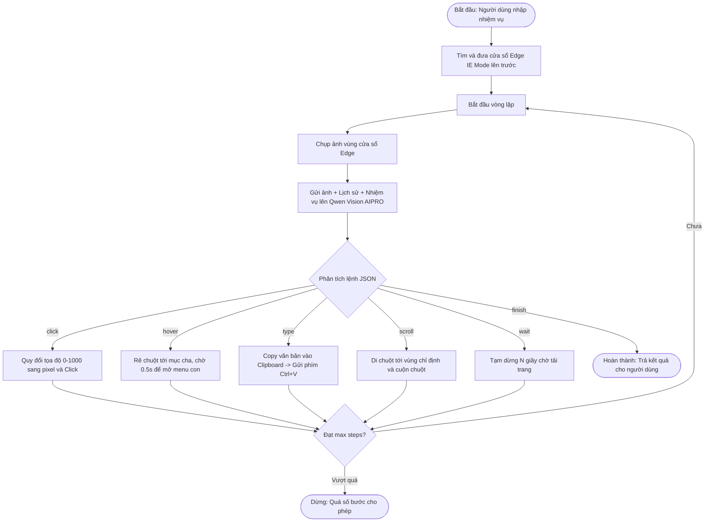

# Design Spec: Edge IE Mode Visual Automation Agent

**Date:** 2026-11-09  
**Status:** Approved for Planning  
**Target:** Legacy Web Automation on Microsoft Edge (IE Mode) using Qwen Vision & PyAutoGUI  

---

## 1. Mục tiêu & Bối cảnh

### 1.1 Bối cảnh
Người dùng cần tự động hóa các trang web nội bộ/cũ vốn chỉ hoạt động trên trình duyệt **Internet Explorer 7 trở lên**. Hiện tại, các trang này đang được mở trên **Microsoft Edge ở chế độ IE Mode** (chạy engine Trident/MSHTML cổ điển).
Vì tab IE Mode không chạy engine Chromium, các công cụ tự động hóa DOM hiện đại (Playwright, Puppeteer) không thể kết nối trực tiếp vào DOM của tab này. Ngoài ra, các trang web cổ thường có menu dày đặc, nhiều cấp (`hover/flyout`), popup ActiveX, hộp thoại cảnh báo và bộ gõ tiếng Việt dễ xung đột.

### 1.2 Mục tiêu
Xây dựng một ứng dụng **Visual AI Agent** bằng Python sử dụng model **Qwen Vision** từ nhà cung cấp **AIPRO** (chuẩn tương thích OpenAI API) để:
1. Tự động nhận diện và chụp ảnh cửa sổ Microsoft Edge đang mở trang web IE Mode.
2. Cho phép Qwen Vision "nhìn" màn hình, suy luận và định vị chính xác các thành phần trên trang web.
3. Điều khiển chuột và bàn phím máy tính thông qua `pyautogui` để click, rê chuột mở menu (`hover`), cuộn trang theo vị trí (`scroll_at`), và điền văn bản an toàn không lỗi font tiếng Việt.
4. Tự động kiểm tra trạng thái màn hình sau mỗi hành động để hoàn thành nhiệm vụ phức tạp nhiều bước.

---

## 2. Kiến trúc hệ thống & Thiết kế chi tiết

### 2.1 Sơ đồ luồng hoạt động (ReAct Loop)



### 2.2 Các giải pháp kỹ thuật cốt lõi

1. **Chuẩn hóa tọa độ tỷ lệ 0–1000 (Coordinate Normalization):**
   * Prompt yêu cầu Qwen trả về tọa độ `[x, y]` từ `0` đến `1000` trên ảnh.
   * Công thức tính tọa độ pixel màn hình thực tế:
     $$X_{\text{screen}} = X_{\text{window\_left}} + \frac{x}{1000} \times W_{\text{window}}$$
     $$Y_{\text{screen}} = Y_{\text{window\_top}} + \frac{y}{1000} \times H_{\text{window}}$$
   * Khắc phục hoàn toàn lỗi lệch tọa độ do cài đặt Windows Display Scaling (125%, 150%).

2. **Xử lý menu dày đặc & Menu đa cấp (Flyout / Hover):**
   * Trang bị action `hover`: Agent di chuyển chuột đến tọa độ menu cha, giữ chuột tại đó và chụp lại màn hình ở bước tiếp theo để Qwen thấy menu con xổ ra trước khi click.
   * Trang bị action `scroll` kèm vị trí `[x, y]`: Cho phép cuộn riêng cột menu bên trái mà không làm trôi toàn bộ trang web.

3. **Gõ chữ an toàn qua Clipboard (Paste-based Input):**
   * Sử dụng thư viện `pyperclip` để copy text vào Windows Clipboard, sau đó gửi phím tắt `Ctrl + V`.
   * Tránh hoàn toàn việc xung đột với Unikey / EVKey và không làm mất ký tự trên các ô input đời cũ của IE.

4. **Cơ chế an toàn (Fail-safe):**
   * Bật `pyautogui.FAILSAFE = True` (di chuột ra góc màn hình để ngắt khẩn cấp).
   * Giới hạn `max_steps` (mặc định 20 bước) để tránh vòng lặp vô tận khi trang web bị treo.

---

## 3. Cấu trúc mã nguồn

Dự án được đặt trong thư mục `edge_ie_agent/`:

```text
edge_ie_agent/
├── .env.example             # Mẫu cấu hình môi trường
├── requirements.txt         # Các thư viện phụ thuộc
├── config.py                # Quản lý cấu hình (API Key, Base URL, Window title)
├── window_manager.py        # Tìm cửa sổ Edge, kích hoạt và chụp ảnh vùng làm việc
├── coordinate.py            # Quy đổi tọa độ [0, 1000] sang pixel Windows
├── controller.py            # Thực thi click, hover, scroll_at, clipboard type
├── qwen_client.py           # Client gọi API AIPRO (OpenAI format, mã hóa Base64)
├── agent.py                 # Vòng lặp ReAct, quản lý lịch sử bước, prompt hệ thống
└── main.py                  # CLI tương tác với người dùng
```

---

## 4. Định dạng trao đổi dữ liệu (LLM Output Schema)

Qwen Vision sẽ được hướng dẫn trả về cấu trúc JSON duy nhất:

```json
{
  "thought": "Giải thích ngắn gọn quan sát trên màn hình và lý do chọn hành động này",
  "action": "click | hover | type | scroll | wait | finish",
  "point": [x, y],
  "text": "Nội dung cần điền nếu action là type",
  "press_enter": false,
  "direction": "up | down",
  "amount": 3,
  "seconds": 2,
  "message": "Nội dung thông báo hoàn thành nếu action là finish"
}
```

---

## 5. Danh mục thư viện phụ thuộc (`requirements.txt`)

* `openai>=1.30.0` (Client gọi API AIPRO chuẩn OpenAI format)
* `pyautogui>=0.9.54` (Điều khiển chuột và bàn phím)
* `pywin32>=306` (Giao tiếp Windows API tìm cửa sổ Edge)
* `pillow>=10.0.0` (Chụp ảnh và xử lý ảnh màn hình)
* `pyperclip>=1.8.2` (Thao tác Windows Clipboard)
* `python-dotenv>=1.0.0` (Đọc biến môi trường từ file `.env`)

---

## 6. Kế hoạch kiểm thử & nghiệm thu

1. **Kiểm thử tìm cửa sổ Edge:** Chạy thử `window_manager.py` khi mở Edge để đảm bảo lấy đúng vùng hiển thị.
2. **Kiểm thử quy đổi tọa độ:** Click thử vào một điểm cố định trên Edge để xác minh tính chính xác của công thức tỉ lệ.
3. **Kiểm thử gọi Qwen Vision AIPRO:** Gửi ảnh chụp thử nghiệm và nhận phản hồi JSON hợp lệ từ endpoint AIPRO.
4. **Kiểm thử End-to-End:** 
   - Test thao tác `hover` vào một menu đa cấp để xem menu con bung ra.
   - Test điền form có tiếng Việt và click nút tra cứu/tìm kiếm.
